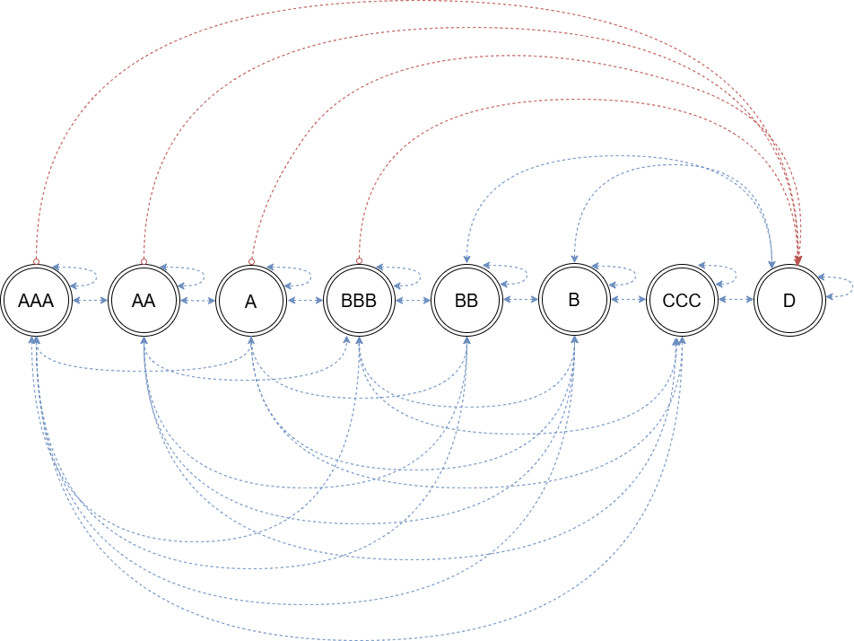
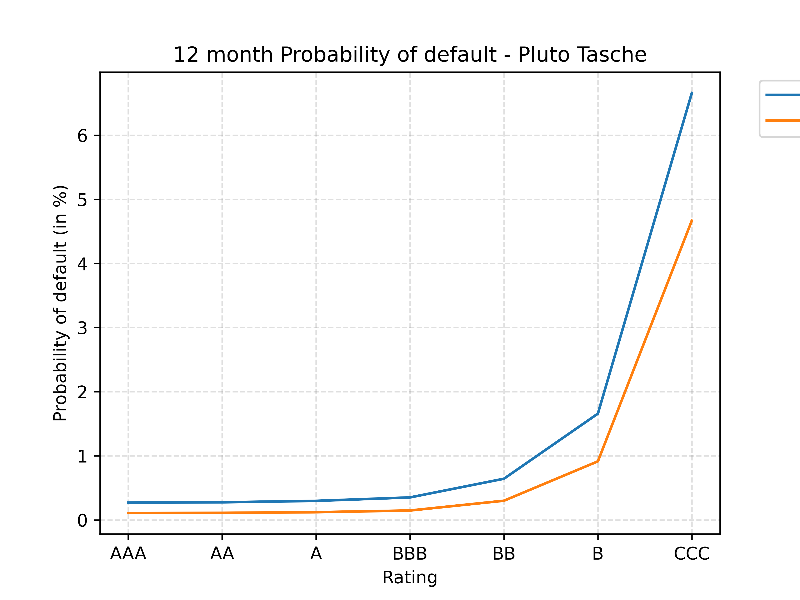

# 
 IFRS 9 Expected Credit Loss : Model Development Documentation 

### ***I. Data preprocessing and data adjustments:***

The loan book was synthetically generated to simulate a subset of a USA's bank portfolio. Subsequently all the amount in USD. The following adjustments were made to ensure portfolio-level plausibility:
+ Grade distribution rebalanced to reflect a realistic mixed portfolio: Original simulation concentrated loans in lower grade buckets (the original dataset had around 4% of the whole book in CCC rated)
+ Tenure values adjusted to ensure remaining term is consistent with origination date and reporting date. The loan tenure was floored at 60 months for Amortising and bullet loans.
+ The revolving loan is renewed at the end of each the year, and the assumption has been made that the bank does not cancel the revolving loan.
+ The Sanction amount was adjusted to map with real world expectations.
+ All data is entirely synthetic and does not represent any real borrower or institution.

---

### ***II. Model Assumptions:***

In the model, there are three types of loans:
* Amortising loans
* Bullet loans
* Revolving loans

In the model, there are four types of Segments :

* Corporate
* Commercial
* Retail, and
* SME (Small and Medium Enterprises)
  
For bullet and amortising loans, the maturity date defines the end of the loan, and for revolving loans the maturity date does not signify an end date but is used as a placeholder value. The bank can reset the loan characteristics at the end of the year.

+ The reporting period is from Q1 2023 to Q4 2025, and the reporting is done on a quarterly basis, with periods ending in March, June, September, December.

+ The rating is taken to be similar to an internal "Master Rating Scale" that a bank maintains. 

+ Loans that are originated within the given quarter (that is the number of months elapsed until the first reporting date is less than or equal to three), the values of DPD would be overwritten as "Current", although, there is a probability (although very small) that the loan could become delinquent within the first quarter.

+ The raw dataset of the portfolio had loans that originated during the reporting period of Q1 2023 - Q4 2025 and those loans have been excluded under the assumption that a static portfolio is taken, and no new loans would originate. Modelling stochastic origination timing (which quarter a new loan enters) without empirical origination-rate data to calibrate against would introduce unsupported assumptions about loan characteristics (amount, interest rate, tenure etc) for hypothetical new business, adding model risk rather than reducing it.

+ <b> Effective Interest Rate Computation : </b>
  - The Effective interest rate (EIR) for revolving loans is taken as the Origination interest rate as a proxy and no fees or additional charges are considered. Furthermore, the time period for computing lifetime PD for revolving loans is assumed to be of 36 months (3 years). As Per IFRS-9 5.5.20 and B5.5.39-B5.5.40, the contractual ability to cancel a revolving facility does not, by itself, limit the ECL measurement period. Entities are required to estimate the period over which they remain economically exposed to credit risk in practice ("behavioural life"), which is often longer than the contractual notice period. In the absence of historical account-level data needed to derive an empirical behavioural life, a flat 3-year assumption is used as a proxy, chosen to align with the model's available reporting window.

  - The Effective interest rate for Amortising and bullet loans is computed under the assumption of no prepayment, zero additional fees, such as origination fees, commitment fees and other charges, and a fixed interest rate set at the time of sanction/ origination date is to be used for the whole tenure of the loan.

+ <b> Definition of Default : </b>

    A default is defined as an event where the borrower has missed three consecutive contractual payments. The account will be marked as "D" : Default. Once the account has been marked as "D", the account will be considered as a "credit-impaired" financial asset (as mentioned in Appendix A "credit impaired financial asset definition point (b) of the IFRS 9 document) and will go in probation, if in subsequent quarter the due amount has been paid, else will go in charge-off where the bank will try to collect payments by selling the collateral or the loan would be rescheduled/ modified (Para 5.5.12), modelling both of which is out of the scope of the current model. The current model only puts the account in charge-off books once the threshold of 90+ DPD consecutive period has been breached.

+ There are three scenarios being considered in the model for Expected credit loss computation : Base, Optimistic and Pessimistic. The probability weights for Base, Optimistic and Pessimistic scenarios are taken as per Moody's Midpoint approach as prescribed in the paper "Deconstructing scenario weights for CECL", 2019.

+ A borrower's Days past due (DPD) can transition among the following:
   - Current
   - 30-59 DPD
   - 60-89 DPD
   - 90+ DPD

  A loan can stay for an elongated period of time in either bucket. The loan would be moved to the charged off book only when there is two (or what the charge off period variable indicates; by default, a 2-quarter period is taken) consecutive 90+ DPD. The reasoning behind this is that since we are modelling at a quarterly frequency at any time when the buckets are 30-59 DPD or 60-89 DPD, given the ceiling they have, it means that the borrower has been paying some amount towards the loan, either with a lag of 1 month or 2 month, depending on the buckets they are in, but has been paying enough to not go in the 90+ DPD bucket and thus it is imperative to keep the loan in the active portfolio for ECL computation. For loans that became 90+ DPD and stayed in that bucket, we can reasonably say that in the quarter, the borrower hasn't paid anything for the last 3 months (~90 days) and if the cycle continues for another quarter, it becomes 6 months (180 days), and thus we can safely put the account and all its subsequent observations in the charge off book. It is further assumed that once an account goes into charge off, that loan will not be considered for ECL estimation purposes even if the DPD bucket becomes "Current" in the next quarter and stays "Current" for the rest of the estimation period. Once an account goes into charge off, following B5.5.25 - B5.5.27, the account, if restructured, will be treated as a "new" financial asset but will not be treated as a Stage 1 account directly. 

+ Bucket transition requires full clearance of all overdue instalments; partial payment reduces DPD by the number of instalments cleared but does not trigger a jump to Current unless all arrears are cleared. In other words, for a loan that moves from 60-89 DPD to 30-59 DPD, the borrower would have paid the month <i> i-1 </i> instalment only, which moves the loan from 60-89 DPD to 30-59 DPD, and the outstanding balance would show the balance based on this principle.

+ The size of the charge-off book itself becomes path dependent such that the number of loans that became 90+ DPD for 2 or more consecutive periods (or what the charge off period variable indicates; by default, a 2-quarter period is taken) differs widely in the three scenarios given the different point-in-time transition matrices being used for rating and DPD estimation. The number of loans to be put into the charge off book at the start of the reporting period might differ if there were different sets of uniform random draws being used, and thus for each path, a different "book" is created to which the loans are transferred.

+ The asset correlation, $\rho$ , is taken as fixed 12% for all loan types when computing the Point in time (PIT) values of transition matix, PD, CCF, and LGD.

+ The monthly contractual payment for amortising loans is computed by assuming the payments happen at the end of the period.

+ The macroeconomic variable chosen for the model is "Unemployment rate" of US market and was collected from the FRED website. The macroeconomic forecast for Base, Optimistic and Pessimistic scenario is computed using the Autoregressive model with one period lag, AR(1), process.

+ The base transition matrix for rating estimation is taken from GARP, Financial Risk Manager book: Valuations and Risk Models (2024) Pg 66 and some amendments were made to it.

#### <u> ***RATING MIGRATION</u> :***

+ This linear state diagram maps our IFRS 9 Markov chain framework. The top arcs indicate that a bad macroeconomic shock could make assets (even pristine AAA) to jump straight to Default (represented by dashed red lines). The bottom arcs represent the fluid, non-linear migrations across grades.
+ For regulatory compliance, the Default state (D) is constrained: it contains strict zero-probabilities for immediate cures back into Investment Grade (AAA through BBB - shown by the red arcs at the top), forcing cured loans through a mandatory speculative grade for at least 1 period. Refer "Markov Chain Simulation Mechanics" under section  III for more information on how ratings are redrawn after the account comes out of probation.

*
* 
   
#### ***Data Transformation:***

+ The Quarter Column is computed to generate *n* new rows for each loan based on the loan sanction date, maturity and last reporting date such that for all loans that originated before the first reporting date and have a maturity before/ after 1  the end of the reporting date, the following formula will be used: 

$$\text{Total Quarters} = (\text{End Year} - \text{Start Year}) \times 4 + (\text{End Quarter} - \text{Start Quarter})$$

$\text{where}$ :

 *End Year*= The maturity date of the loan (amortising / bullet) or the end of the reporting period (which is Q4 2025), whichever is earlier.
 
 *Start Year*= The Sanction Date of the loan or the start of the reporting period (which is Q1 2023), whichever is later.

+ The Month on books (MOB) is computed as follows : 

$$\text{MOB} = [(\text{Current Year} - \text{Origination Year}) \times 12] + (\text{Current Month} - \text{Origination Month})$$

$\text{where}$ :

*Current year* = The reporting year

*Origination year* = This is the year when the loan was sanctioned

*Current month* = The Reporting month

*Origination month* = This is the month when the loan was sanctioned

<b> Note : </b> 

1. The end of reporting date for revolving loans is taken to be the end of the reporting period - Q4 2025.

### III. ***Expected Credit Loss (ECL) Parameters :***

#### A. Probability of Default Computation :
 
The computation of Probability of default (PD) under the model is done using two models : Pluto Tasche model and the Hazard Rate model.

First, the Pluto Tasche model is used to compute the 12-month PD for each rating grade - AAA, AA, A, BBB, BB, B, CCC - under the assumption that there are 0 defaults in the portfolio. This model was chosen because :
        
   - the model had no defaults so the standard logistic regression could not be used to derive the PD,
   - Given the size of the active portfolio (1281 loans after filtering as compared to the 1500 loans in the raw dataset), and to get a conservative estimate of PD for such a small portfolio, Pluto Tasche was deemed to be a suitable choice.

The PD's for each rating is first computed under the assumption of no correlation between borrowers, once that PD is computed, the model then computes the PD assuming correlation between borrowers with an asset correlation of 12% and a confidence interval of 75%, as prescribed by Pluto and Tasche (2005).

Once the 12 month PD's for each rating grade is computed, the lifetime PD is computed for each scenario using the Hazard rate model, where the hazard rate, $\lambda$, is first extrapolated from the 12 month PD and then using the value of $\lambda$, lifetime PD is computed, which is then further converted to Point-in-time (PIT) using the macroeconomic forecast value at each quarter and a fixed asset correlation of 12% using the Vasicek model. 

Lambda is computed as : 
 $\lambda$r = ${- ln(1- {PD_{12m,r}})}$

${where : }$ 

${r =}$ credit rating for which lambda is being computed.

 
 PD at time <i> t </i> is computed using the following formula : 
 
 ${PD_{r,t}}$ = 1- $e^{-\lambda_{r} t}$
 
 ${where :}$
 
 ${t = }$ time left to maturity (in years)
 
 ${r = }$ credit rating grade

+ The PD's are assumed to be representing a Master Rating Scale PD given that the model has different sectors (Retail, Corporate, Commercial and SME).

| PD Pluto Tasche | Hazard Rate PD |
| :---: | :---: |
|  | 

*
*

#### B. Loss Given Default Computation :

The Loss given default is not computed using a statistical model such as regression, in fact base values are assumed for each segment and are then converted to point in time LGD using the Vasicek model. The LGD base values can be changed as per user needs.
Loss Given Default was not estimated via a regression model because doing so on synthetic data would require fabricating the underlying recovery drivers (collateral realization value, seniority, workout timing) and the relationship between them and outcome — meaning the regression would simply recover a pre-specified relationship rather than estimate an unknown one. Instead, segment-level base LGD values were set with the intention of "Expert judgement" and converted to point-in-time estimates via the Vasicek model, reflecting how LGD assumptions are commonly calibrated in practice when internal loss-given-default data is limited or unavailable.

*
*

#### C. Exposure at Default : 

Exposure at default (EAD) differs slightly for each loan type : 

##### 1. Amortising Loans:

For Amortising loans, it is assumed that no prepayments have happened at any time - before or during the reporting period - and interest rate charged on the loan is taken to be fixed.
At each reporting period, outstanding balance is being computed for amortising loan in the "Outstanding_Balance" column, showing the contractual payments that is paid towards the loan assuming no defaults. After the credit ratings and Days past due (DPD) buckets of the borrower are estimated, EAD is calculated again based on which bucket the loan is in each quarter under each scenario : 
 
 - If DPD is "Current" - Outstanding balance for month <i> i </i> is taken as is for the given month from the "Outstanding_Balance" column.
   
 - If DPD is "30-59 DPD" - Outstanding balance is computed at month <i> i - 2 </i> (the beginning balance in the last month) and one month interest is added back to get the EAD value. The interest amount being added is the actual interest portion of the contractual monthly instalment.
 
 - If DPD is "60-89 DPD" - Outstanding balance is computed at month <i> i-3 </i> (the beginning balance in the month before the last month) and two month's interest is added back to get the EAD value.
 
 - If DPD is "90+ DPD" - EAD is computed based on how many quarters, capped at two consecutive quarters by default (or what the charge off period variable indicates), is the account in the "90+ DPD" bucket and based on that outstanding balance is computed and interest is added for all those months.
 
 <b> Note : </b> When calculating the outstanding balance when the account is in 90+ DPD, it is assumed that the account becomes 90+ in that quarter and what the DPD was in previous quarter is not taken into consideration due to the following reason: 
 
  - When an account transitions into 90+ DPD for the first time i.e., the prior quarter's bucket was Current, 30-59 DPD, or 60-89 DPD, the exact month within that quarter the account crossed the 90-day threshold cannot be recovered from quarterly-level data alone. Rather than inferring this from the prior quarter's bucket (which would require monthly-level assumptions beyond what the data supports), the model assumes the standard progression: 30+ DPD in month 1, 60+ DPD in month 2, 90+ DPD in month 3 (the reporting month) — i.e., a fixed 3-month missed-payment count for the first occurrence, regardless of what the immediately preceding bucket was. This is a deliberate simplification to avoid introducing monthly-level assumptions the data cannot support currently. For example, if in quarter <i> i -1 </i>, the DPD bucket was either 30-59 DPD or 60-89 DPD and the quarter <i> i </i> DPD is 90+ DPD, under a monthly forecasting, we could see that the 90+ DPD could reach in either two or one months, respectively and the current quarter's 90+ DPD account may in reality have accumulated more than the assumed 90 days delinquent, depending on where within the prior bucket's day-range the account actually sat.
  - This simplification understates the potential missed- accrued  outstanding balance by at least 30 days (up to 59 days) if the previous quarter was 30-59 DPD, or at least 60 days (up to 89 days) if the previous quarter was 60-89 DPD. 
    
For accounts that remain 90+ DPD in the following quarter and beyond, this fixed 3-month assumption no longer applies — the model instead uses the consecutive 90+ streak counter to extend the lookback proportionally (see "Further Information for Amortising/ Bullet Loans" below), since by that point the account has demonstrably been delinquent for longer than one quarter and the streak count itself is known with certainty.

##### 2. Bullet Loans : 

+ The outstanding balance for Bullet loans is set as the Sanction Amount as it is assumed that the borrower will continue to pay the interest due each month. The interest amount is computed as a simple interest on the sanction amount under the normal course of action, and if the borrower is marked as a defaulter, compounding interest would be computed and will be reflected in a separate column titled "EAD_{scenario}", which will be used in the computation of Expected Credit Loss (ECL) for the borrower. After the credit ratings and DPD buckets of the borrower are estimated, EAD is calculated based on which bucket the loan is in each quarter : 

 - If DPD is "Current" - EAD will equal the Sanction amount.
   
 - If DPD is "30-59 DPD" -  One month interest* is added to the Sanction amount to get the EAD value.
 
 - If DPD is "60-89 DPD" - Two month's interest* is added to the Sanction amount to get the EAD value.
 
 - If DPD is "90+ DPD" - Outstanding balance is computed based on how many quarters is the account in the "90 + DPD" bucket and based on that compounding interest would be computed to get the EAD value.

<b> * </b> <i> As a conservative simplification, the model compounds interest on the full outstanding principal rather than isolating only the overdue interest instalments, resulting in a more conservative (higher) EAD estimate for defaulted bullet exposures than a strict interest-only accrual would produce. </i>

##### Further information for Amortising/Bullet Loans — Delinquency-Adjusted Outstanding Balance

DPD bucket is treated as a lagged indicator of missed instalments: because DPD is evaluated on a monthly reporting period, an unpaid instalment due mid-month cannot cross a 30-day threshold before month-end, so bucket transitions are observed with a one-month lag relative to the date of the first missed payment. Consequently, for a loan in DPD bucket implying k consecutive missed instalments as of month MOB, the last successfully paid instalment corresponds to month MOB − k − 1. EAD is computed by (i) computing the outstanding principal as of that anchor month via the standard annuity remaining-balance formula, and (ii) adding the scheduled interest (IPMT) components of the k subsequently missed instalments, each computed off the original amortization schedule at the corresponding payment index. 
Bucket-to-k_month mapping: Current → 0, 30-59 DPD → 1, 60-89 DPD → 2, 90+ DPD → 3 × (consecutive quarterly 90+ streak count), reflecting quarterly reporting granularity. The 90+ DPD streak-based k is capped at a segment-specific maximum (default: 2 quarters / 6 months), beyond which EAD is held flat and the exposure is flagged for charge-off treatment, consistent with regulatory retail charge-off conventions.

##### 3. Revolving Loans : 

+ The outstanding balance column for revolving loans shows the drawn balance by the borrower, which is computed assuming a uniform distribution for each loan separately with the lower and upper bound set at 0.5 and 0.95, respectively and the EAD would be computed using the CCF adjustment for Base, Optimistic and Pessimistic Scenario. The base CCF values for each sector is assumed and the CCF is then converted to point in time CCF using the Vasicek model.

After the credit ratings and DPD buckets of the borrower are estimated, EAD is calculated based on which bucket the loan is in each quarter : 

$${EAD_{t}} = \text{Drawn Balance} + (\text{CCF} \times (Sanction Amount - Drawn Balance))$$

 - If DPD is "Current" - Drawn balance is taken as is at time t and then the EAD is computed using the above method.
   
 - If DPD is "30-59 DPD" -  One month interest is added back to the value of the corresponding drawn balance.
 
 - If DPD is "60-89 DPD" - Two month's interest is added back to the value of the corresponding drawn balance.
 
 - If DPD is "90+ DPD" - The amount to which interest is added depends on the occurrence of the 90+ DPD. If the 90+ DPD has occurred for the first time then the previous quarter's drawn balance is used to which interest is computed as well, the drawn balance is floored at the first row of a particular borrower because estimating the drawn balance before the first reporting period using the uniform distribution would add further noise to the model without adding significant accuracy.

+ When looking at the counter values for DPD buckets, the values are taken as such :
  
    - When the DPD is marked as "30-59 DPD", the counter value is always 1, which represents 1 month delay, no matter how many consecutive values there are in the data.
    - When the DPD is marked as "60-89 DPD", the counter value is always 2, which represents 2-month delay, no matter how many consecutive values there are in the data.
    - When the DPD is marked as "90+ DPD", the counter value signifies the number of quarters the payment is due. So, a value of 1 means 1-quarter and 2 means 2-quarters, which is then multiplied by 3 to get the corresponding months, which means the model takes 3 when the DPD is 90+ and the counter is 1 and it takes 6 when the counter is 2. The value to be capped is defined based on the "Segment" column and is kept variable, which can be changed as well, depending on use case.

+ As per IFRS 9 para 5.5.19, ECL for loans is computed up to the point the bank is exposed to the credit risk, that is, amortising and bullet loans ECL is computed up to their maturity and for revolving loans, ECL is computed until the end of the reporting period since there is no defined maturity.

###### Drawn Balance Evolution Between Quarters: 

For revolving loans, the drawn balance at each quarter is not tracked at a monthly level, and quarter-over-quarter changes in `Outstanding_Balance` is not reconciled against actual repayment or drawdown activity. Instead, it is simply assumed that whatever balance is observed in the current quarter reflects a fresh drawdown by the borrower i.e., any prior balance is assumed to have been repaid in full before the new balance shown was drawn. For example, if a borrower shows a drawn balance of 20,000 in quarter <i> i−1 </i> and 25,000 in quarter <i> i </i> (against a sanction/limit of 30,000), the model assumes the 20,000 was repaid in full and a new 25,000 was subsequently drawn — not that 5,000 in additional credit was drawn on top of an unpaid 20,000.

This assumption applies only when the account is <b> <i> not in 90+ DPD </i> </b>. For 30-59 DPD and 60-89 DPD, the current row's `Outstanding_Balance` is used as-is (per the EAD rules above), since the exact month within the quarter that the account entered delinquency cannot be inferred from quarterly data, consistent with the same limitation already noted for amortising/bullet loans. For 90+ DPD, the balance is instead anchored to the value from n quarters prior (per the counter-based lookback), floored at the borrower's first reported quarter where insufficient history exists, to avoid introducing additional randomness from re-sampling a new balance during an active default episode.

#### D. Stage Classification, ECL Computation, probation period, DPD and rating computation : 

+ Accounts are classified into three stages - Stage 1, Stage 2, and Stage 3 - as per the IFRS 9 regulation. All accounts on the Sanction date are classified as Stage 1, by default and subsequently the DPD is marked as "Current" for those accounts as it is assumed that no "credit-impaired" financial asset is bought by the banks.

+ A <b> Significant increase in credit risk (SICR) </b> is determined at a PD threshold level of 150%, by comparing the ratio of the 12-month PD at the time of reporting and the 12-month PD at the time of Sanction for each reporting date. If the threshold is breached at any given reporting date (Para 5.5.3), the account is transferred to Stage 2 and lifetime ECL is computed, else 12-month ECL is computed (Para 5.5.7). This exercise is performed for each scenario separately.

+ By default, a probation period of 2 quarters (6 months) is used across the book, and lifetime ECL is computed. Note that under probation ratings are marked as "D" and thus the PD is 100% and stage is marked as 2 when the loan is under probation. After the probation period is over and the account is not 90+ DPD, the ratings are re-estimated from the previous quarter rating (which will be a rating of "D") (See "Markov Chain Simulation Mechanics" for more information on how ratings are re-estimated), followed by SICR trigger check. 

+ <b> ECL Computation : </b>
   After computing the values of PD, LGD, and EAD for all three scenarios : Base, Optimistic and Pessimistic, where PD is computed as per the Staging classification described above, i.e., 12-month PD for Stage 1 accounts, and lifetime PD for Stage 2 and Stage 3 accounts, with Stage 3 PD set at 100%. The lifetime PD is computed using the hazard rate model by first computing the lambda using the 12-month PD we got from the Pluto Tasche model. The Point-in-time LGD and the EAD values are then used to get to the ECL values, which is then discounted using the respective borrower's Effective interest rate (EIR) back to the first reporting date, which is 31st March 2023. The ECL values for base, optimistic, and pessimistic scenarios are computed separately such that for each scenario, the model computes a separate PD, LGD and EAD based on the different factors such as Stage classification, DPD bucket, the macroeconomic forecast (Z) for that scenario and the effect of Z in the point in time estimates of PD, LGD and CCF.

+ The DPD and rating estimation are computed under two phases :

    - The rating for each borrower's first observation is computed by taking the rating at the time of sanction and using a TTC - transition matrix4, a quarterly forecast is done for "n" quarters, where "n" refers to the number of quarters elapsed from the sanction date to the first reporting date. After that, the ratings are then estimated using the previous quarter rating's using the PIT- transition matrix. The same procedure is executed for DPD bucket estimation such that for the first reported quarter, a starting DPD of "Current" is passed into the function and using the TTC - Transition matrix, DPD is estimated for the first observation. After that, the DPD is then estimated using previous quarter's DPD using the PIT - Transition matrix.
  
      <b> Note : </b>

      <b> <i> 1. </i> </b> If the loan originated within the first reported quarter date or within the quarter previous to the first reported, ratings are kept equal to the sanction rating and DPD is marked as "Current". 

      <b> <i> 2. </i> </b> The transition matrix being used (both TTC and PIT) are cumulative quarterly transition matrix.

      <b> <i> 3. </i> </b> The rating and DPD estimations are done separately, and ratings are tied with the DPD only at the instances where DPD became 90+ DPD, after which probation period is applied within the function. The rating and DPD are estimated using Markov chains concept.

      <b> <i> 4. </i> </b> The use of TTC - transition matrix is done because different loans originated at different points in time, going back till 2010, so using a separate PIT - transition matrix would have increased computational complexity and given the timeframe of more than a decade, the values would eventually converge to a long run average.

      <b> <i> 5. </i> </b> For the first reporting date specifically, probation applicability is determined by examining the borrower's simulated history (available via the `return_history` argument of the Markov simulation function) going back the number of quarters specified by the probation period parameter. If the account was in 90+ DPD at any point within that lookback window, which is the number of required probation period as set out by the bank (default is of 2 quarters), probation is applied to the first reporting date's rating regardless of the DPD bucket estimated for that date — ensuring loans that defaulted late in the estimation phase are not incorrectly treated as cured the moment the reporting period begins.

#### E. Charge off accounting: 

There are 4 segments in the portfolio :

   * Retail
   * SME
   * Corporate, and
   * Commercial

For the current model, a flat 2 quarter (180 days) threshold is chosen for all segments, but the flexibility of changing values of charge-off period for each segment is provided to mimic the real-world dynamics.
For charge off loans, once an account has been flagged to be sent to charge off books, all the subsequent rows of that borrower are put into charge off and no further ECL estimation is done. However, as the regulations states that charge off loans can be cured and can then revert back to the active loans, but for this model, it is not assumed that the loans will revert back to active loans book. Although, in the model, the Stage classification and DPD buckets might indicate that some loans did get cured after being in default for a brief period, but since the accounts would go in charge off books, the subsequent ratings and DPD does not matter.

##### Markov Chain Simulation Mechanics

Both rating and DPD are modelled as discrete-time, discrete-state Markov chains, where the state at quarter <i> t </i> depends only on the state at <i> t-1 </i> and the applicable transition matrix (TTC for first observation, PIT for the reporting period). The rating chain includes an absorbing-with-reflection default state: once "D" is reached, the chain is held at "D" for a fixed probation window (parametrized, default 2 quarters) rather than transitioning freely, after which it is re-drawn — with the constraint that re-entry cannot land directly in an investment-grade state for rating, and the redraw is repeated (a rejection-sampling loop) until a valid non-"D" state is returned given the probation period has ended. This path-dependency is what necessitates simulating the full chronological sequence per loan rather than sampling terminal states independently — a defaulted-then-cured loan's subsequent risk parameters depend on when and how it cured, not just its current label.

Loans originated before the reporting window are simulated through a lookback phase (sanction date → first reporting date) using the same TTC-chain mechanics, and the terminal state (rating, DPD, and consecutive-90+ streak count) is carried forward as the initial condition for the reporting-period simulation — ensuring loans with pre-existing delinquency are not treated as clean at the start of the reporting window.

##### Supplementary Analysis : Interest rate spread v/s Federal Funds rate

As part of initial exploration into EIR estimation, historical average interest rates charged (by loan type, back to 2010) were benchmarked against the Federal Funds Rate to characterize the bank's implied lending spread (Amortising: ~5.04%, Bullet: ~4.97%, Revolving: ~5.11% above Fed Funds rate). While this approach was ultimately not used for EIR computation in the current model (EIR is instead taken directly from origination rate under a fixed-rate assumption), the derived spread values are retained as a foundation for a planned future enhancement: forecasting Fed Funds Rate and applying a constant spread to relax the fixed-interest-rate assumption along with other enhancements.

##### Validation : 

Automated portfolio-level reconciliation checks were run covering EAD non-negativity, categorical field integrity, charge-off propagation monotonicity, cross-scenario consistency of static fields, and row-count reconciliation against contractual tenure. Instances of amortising-loan EAD exceeding sanction amount were investigated and found consistent with expected model behavior — concentrated in loans with sustained 90+ DPD streaks combined with high origination interest rates, where accrued missed-interest correctly compounds the exposure above original principal.

---

### ***IV. Model Limitation and Future Improvements :***

 + When computing Point in time values, for PD, the prescribed measure is to take multiple macroeconomic variables (MEV) such as Unemployment, GDP, inflation, and more recently climate related variables. But, for the MEV to be used within the Vasicek model, we need to convert it using the Z-score methodology wherein we first extrapolate the macroeconomic index (our "Z") using the bank's historical dataset and check the default rate at each point in time and using the following formula derive the Z. The formula is as follows: 
   
 $${Z_{i}} = \frac{\Phi({PD_{TTC}}) - \Phi^{-1}({PIT-DR_{i}}) \times \sqrt{1-\rho}}{\sqrt{\rho}}$$

$\text{where}$ :
 
$\Phi$ = Standard Normal distribution function
 
$\Phi^{-1}$ = Inverse of the Standard normal distribution function
 
$\rho$ = asset correlation
  
   We then use these historical Z values and fit a regression model with our macroeconomic variables and then use the result of the regression to forecast the value of "Z". Since the example we are working on is on a synthetic dataset, performing this exercise would have caused data mismatch and thus, a simple, single macroeconomic variable - Unemployment rate - was taken. The Unemployment rate values were standardised, and the resulting forecasted Z-value will be used to compute point in time PD, CCF and transition matrices for each reported quarter.
   
+ The model assumes that there is a fixed interest rate among all loans, which is hardly the reality. Furthermore, the model also assumes that there are no prepayments happening, which does not depict reality especially under an economic expansion period, where borrowers tend to pay down extra. In a previous model, titled "AmortizeXcelerator", I had worked on this previously, where for any given loan, one can change the interest rate at any month and can pay any amount towards prepayment, following which the model computes the new equally monthly instalment amount or the reduction of tenure, linking that model theoretical knowledge to this would be a great addition where we can estimate values for SSM or CPR under different economic scenarios as well. 

+ DPD bucket only encodes a minimum missed-instalment count (e.g., an account with 2 missed instalments and one with 1 missed instalment can both display as 30-59 DPD within the same day-count window), EAD computed off the bucket-implied minimum k may understate true delinquent balance in cases where more instalments are unpaid than the bucket floor implies. This is a conservative-direction approximation inherent to reconstructing daily delinquency state from monthly/quarterly bucketed data.

+ Current ECL reflects one stochastic Markov realization per scenario, not an averaged estimate over repeated draws, and this is a planned v2 enhancement where multiple scenarios are executed to see different paths of how the ECL behaves in each scenario.

+ In the current version of the model, accounts are marked as Stage 2 purely by considering the ratio of the 12-month PD at the time of reporting and the 12-month PD at the time of sanction. An account can stay for an elongated period of time in 30-59 DPD or 60-89 DPD but still be marked as Stage 1 if the threshold is not breached.

+ DPD and rating are currently modelled as independent Markov processes, tied together only at the 90+ DPD/probation boundary (rating forced to "D"). In reality, sustained delinquency in lower buckets (e.g., 3-4 consecutive months in 30-59 DPD or 60-89 DPD) would typically also pressure a bank's internal rating downward well before an account reaches 90+ DPD, which the current model does not capture - at least not deliberately. A more accurate architecture would model rating and DPD as a Markov process (or, more specifically, jointly over a combined (Rating × DPD) state space) rather than as two independently transitioning chains linked only at a single boundary condition. This was not implemented in the current model because it requires either a larger joint transition matrix (Rating grades × DPD buckets) or a clearly defined conditional structure (which variable's transitions should be conditioned on the other), both of which need further methodological design before implementation.

    Although rating and DPD are simulated as formally independent Markov chains, both are conditioned on PIT transition matrices derived from the same underlying macroeconomic factor (via the Vasicek model), providing a degree of systematic co-movement between rating and DPD deterioration at the portfolio level during adverse macro conditions. This does not, however, capture idiosyncratic (borrower-specific) movements — i.e., a given account's own sustained delinquency history directly influencing its own rating trajectory beyond what the shared macro environment implies for the portfolio as a whole.

---

IFRS9-Version 1.0 July 2026.

<b> Developer : Arsh Sadh </b>
