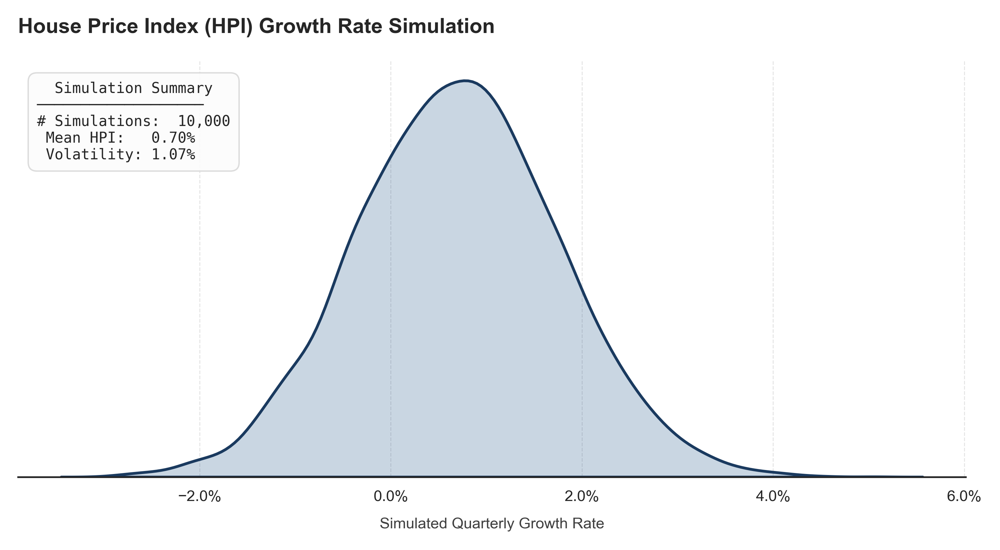
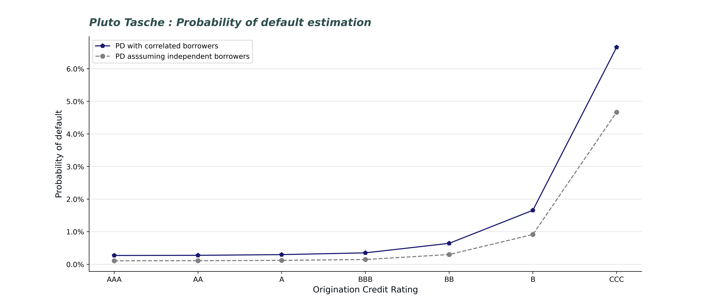
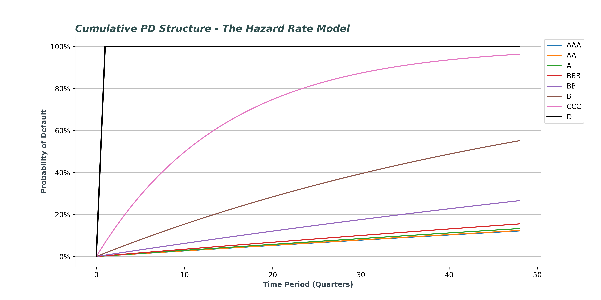
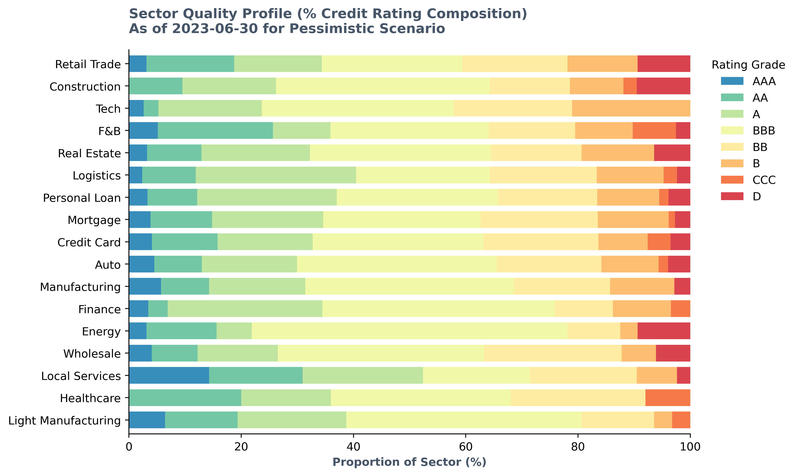
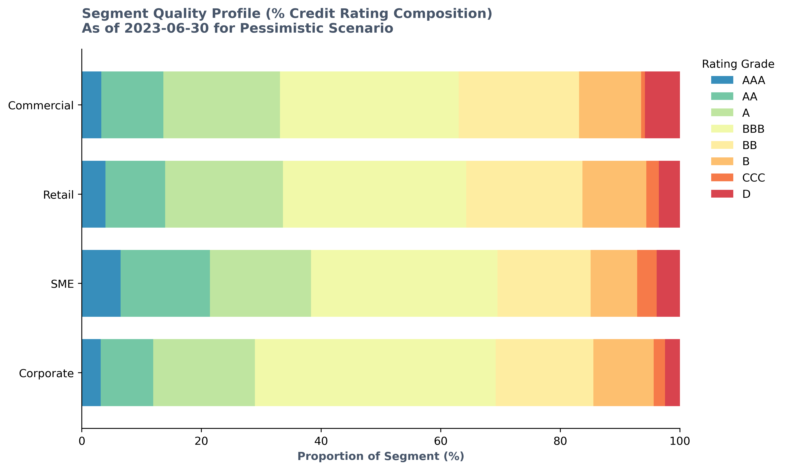

# 
 IFRS 9 Expected Credit Loss : Model Development Documentation 

 

As a direct response to the global financial crisis, the IASB rolled out the IFRS 9 standards to mandate a forward-looking expected credit loss model, requiring financial institutions to estimate losses and to make provisions for them rather than waiting for the default event to happen and then make provisions.

The following model is developed in view of the IFRS 9 standards and aim to show how an estimate of Expected Credit Loss (ECL) is computed, precisely how the ECL parameters : Probability of default (PD), Loss Given Default (LGD) and Exposure at Default (EAD) are computed. 

$$ \text{PV}_{ECL_{i,n}} = \frac{\text{PD}_{i,n} \times \text{LGD}_{i,n} \times \text{EAD}_{i,n}}{(1+r)^{n}} $$

$ where : $

$ \text{i refers to the i}^{th} \text{borrower}  $

$ \text{n refers to the n}^{th} \text{period}  $

$ \text{r is the interest rate} $

$ \text{PD}_{i,n} \text{ = Point in time probability of default of the i}^{th} \text{ borrower at n}^{th} \text{ period}  $

$ \text{LGD}_{i,n} \text{ = Point in time loss given default of the i}^{th} \text{ borrower at n}^{th} \text{ period}  $

$ \text{EAD}_{i,n} \text{ = Exposure at default of the i}^{th} \text{ borrower at n}^{th} \text{ period}  $

The model aims to highlight how the three risk parameters are computed and then converted to a point-in-time estimate to compute the ECL. Furthermore, the model uses the concept of Markov chains to demonstrate how Days past due (DPD) and credit ratings can be estimated. Furthermore, the model also implements the probation period, charge-off of accounts but does not model curing of accounts (See Section II : Model Assumptions point 7). The model has three scenarios (Base, Optimistic and Pessimistic), but the code has been made flexible to extend to $\text{n}$ scenarios, with slight modifications (See Section V : Model limitations and future enhancements) to the code in certain areas. All the necessary variables are declared at the start of the code to make it more accessible, efficient, and easier to update the code later.

This project relies on the following Python environment and library versions :

##### Python Runtime  : **Python Version**: `3.13.9`

**Third-Party Libraries versions** :

| **Library / Package**| **Version**      |
| :---------------:| :-------------------:| 
|  Pandas          |     2.3.3            |
|  NumPy           |     2.3.5            |
|  Matplotlib      |     3.10.6           |
|  SciPy           |     1.16.3           |
|  Statsmodels     |     0.14.5           |
|  Plotly          |     6.3.0            |
|  Seaborn         |     0.13.2           |
|  IPywidgets      |     8.1.7            | 
|  rich            |     14.2.0           |
|  Pyxirr          |     0.10.8           |
|  CVXPY           |     1.9.2            |
|  kaleido         |     1.4.0            |
|  risk_kit        | Own function library |

**Built-in Python Standard Modules :**

The following modules are heavily utilized throughout the codebase but do not require standalone installation (tied directly to the core Python installation):
- `os`
- `gc`
- `time`
- `itertools`
- `importlib`
- `concurrent.futures`

**Note** :  <i> *risk_kit python file was developed within the model and contains the functions necessary to perform the Monte Carlo simulation of ECL. </i>

### ***I. Data preprocessing and data adjustments :***

The loan book was synthetically generated to simulate a subset of a USA's bank portfolio. All the amount is in USD. The following adjustments were made to ensure portfolio-level plausibility:
+ Grade distribution rebalanced to reflect a realistic mixed portfolio: Original simulation concentrated loans in lower grade buckets (the original dataset had around 4% of the whole book in CCC rated).
+ Tenure values adjusted to ensure remaining term is consistent with origination date and reporting date. The loan tenure was floored at 60 months for Amortising and bullet loans.
+ The Sanction amount was adjusted to map with real world expectations.

The documentation is structured as follows :

**Section II** discuss the assumptions that the model uses and dis the reasoning behind why those assumptions were made.

**Section III** of the document explains how each parameter that is used in the model from the transition matrix, macroeconomic model to estimate the macroeconomic index, what PD model was used, LGD estimates and how EAD computation is done under the different loan types, et cetera. For PD and LGD, a further discussion has been made on how PD and LGD values were converted to Point-in-time (PIT) values using the Vasicek model. After that, we shift to explain how staging was classified, which is a requirement under the IFRS 9 standard.

**Section IV** of the document explains the Monte Carlo simulation algorithm used in the model. This model is a natural extension to $n$ iterations as can be seen in version 1 of the model to get a better estimate of ECL for a given reporting date. 

**Section V** of the document concludes and shares the limitations the current model has and the natural upgradations of the model to better estimate the value of Expected credit loss (ECL). 

---

### ***II. Model Assumptions :***

In the model, there are three types of loans:
* Amortising loans
* Bullet loans
* Revolving loans

and there are four types of segments :

* Corporate
* Commercial
* Retail, and
* SME (Small and Medium Enterprises)
  
<b>1.</b> For bullet and amortising loans, the maturity date defines the end of the loan, and for revolving loans the maturity date does not signify an end date but is used as a placeholder value. The bank can reset the loan characteristics at the end of the year.

<b>2.</b> The reporting period is from Q1 2023 to Q4 2025 (12 quarters or 36 months), and the ECL estimation is done on a quarterly basis, with periods ending in March, June, September, and December.

<b>3.</b> The rating is taken to be similar to an internal **Master Rating Scale** that a bank maintains. 

<b>4.</b> Loans that are originated within the given quarter (that is the number of months elapsed until the first reporting date is less than or equal to three), the values of DPD would be overwritten as "Current", although, there is a probability (although very small) that the loan could become delinquent within the first quarter.

<b>5.</b> The raw dataset of the portfolio had loans that originated during the reporting period of Q1 2023 - Q4 2025 and those loans have been excluded under the assumption of a static portfolio, and no new loans would originate during the forecasting period. Modelling stochastic origination timing (which quarter a new loan enters) without empirical origination-rate data to calibrate against would introduce unsupported assumptions about loan characteristics (amount, interest rate, tenure et cetera) for hypothetical new business, adding model risk with high upside risk and less reward.

<b> 6. Effective Interest Rate Computation : </b>
  - The Effective interest rate (EIR) for revolving loans is taken as the Origination interest rate as a proxy and no fees or additional charges are considered. Furthermore, the time period for computing lifetime PD for revolving loans is assumed to be of 36 months (3 years), which is our reporting period of Q1 2023 to Q4 2025. As Per IFRS-9 5.5.20 and B5.5.39-B5.5.40, the contractual ability to cancel a revolving facility does not, by itself, limit the ECL measurement period. Entities are required to estimate the period over which they remain economically exposed to credit risk in practice ("behavioural life"), which is often longer than the contractual notice period. In the absence of historical account-level data needed to derive an empirical behavioural life, a flat 3-year assumption is used as a proxy, chosen to align with the model's available reporting window.

  - The Effective interest rate for Amortising and bullet loans is computed under the assumption of no prepayment, zero additional fees, such as origination fees, commitment fees and other charges, and a fixed interest rate set at the time of sanction/ origination date is to be used for the whole tenure of the loan.

<b>7.</b> <b> Definition of Default : </b>

A default is defined as an event where the borrower has missed three consecutive contractual monthly payments (90 days past due or 90+ DPD). The account will be marked as "D" : Default. Once the account has been marked as "D", the account will be considered as a "credit-impaired" financial asset (as mentioned in Appendix A "credit impaired financial asset definition point (b) of the IFRS 9 document). The loan will go in probation (that is account's DPD is < 90+ DPD but will still be marked as "D"), if in subsequent quarter the due amount has been paid, else will go in charge-off where the bank will try to collect the due amount by selling the collateral or the loan would be rescheduled/ modified (Para 5.5.12).
Modelling of charge-off and curing of accounts is out of the scope of the current model and it is assumed that after curing the loan would be treated as a new loan and to align with the assumption 5 above, the current model only puts the account in charge-off books once the threshold of 90+ DPD consecutive period count has been breached.

<b> 8. </b> There are three scenarios being considered in the model for Expected credit loss computation : Base, Optimistic and Pessimistic. The probability weights for Base, Optimistic and Pessimistic scenarios are taken as per Moody's Midpoint approach as prescribed in the paper "Deconstructing scenario weights for CECL", 2019.

<b> 9.</b> A borrower's Days past due (DPD) can transition between the following:
   - Current
   - 30-59 DPD
   - 60-89 DPD
   - 90+ DPD

  A loan can stay for an elongated period of time in either bucket. The loan would be moved to the charged off book only when there is two (or what the charge off period variable indicates; by default, a 2-quarter period is taken) consecutive 90+ DPD. The reasoning behind this is that since we are modelling at a quarterly frequency at any time when the buckets are 30-59 DPD or 60-89 DPD, given the ceiling they have, it means that the borrower has been paying some amount towards the loan, either with a lag of 1 month or 2 month, depending on the buckets they are in, but has been paying enough to not go in the 90+ DPD bucket and thus it is imperative to keep the loan in the active portfolio for ECL computation. For loans that became 90+ DPD and stayed in that bucket, we can reasonably say that in the given quarter, the borrower hasn't paid anything for the last 3 months (~90 days) and if the cycle continues for another quarter, it becomes 6 months (180 days), and thus we can safely put the account and all its subsequent observations in the charge off book (assuming charge off threshold as 2). It is further assumed that once an account goes into charge off, that loan will not be considered for ECL estimation purposes even if the DPD bucket becomes "Current" in the next quarter and stays "Current" for the rest of the estimation period. Once an account goes into charge off, following B5.5.25 - B5.5.27, the account, if restructured, will be treated as a "new" financial asset but will not be treated as a Stage 1 account directly and thus assumption 5 would be applicable.

+ Bucket transition requires full clearance of all overdue instalments; partial payment reduces DPD by the number of instalments cleared but does not trigger a jump to Current unless all arrears are cleared. In other words, for a loan that moves from 60-89 DPD to 30-59 DPD, the borrower would have paid the month <i> i-1 </i> instalment only, which moves the loan from 60-89 DPD to 30-59 DPD, and the outstanding balance would show the balance based on this principle.

<b> 10.</b> The size of the charge-off book itself becomes path dependent such that the number of loans that became 90+ DPD for 2 or more consecutive periods (or what the charge off period variable indicates; by default, a 2-quarter period is taken) would differ in the three scenarios given the different point-in-time transition matrices being used for rating and DPD estimation. The number of loans to be put into the charge off book at the start of the reporting period might differ if there were different sets of uniform random draws being used, and thus for each path, a different "book" is created to which the loans are transferred.

<b>11.</b> The asset correlation, $\rho$ , is taken as fixed 12% for all loan types when computing the Point in time (PIT) values of rating and DPD transition matrix, PD, CCF, and LGD.

<b>12.</b> The monthly contractual payment for amortising loans is computed by assuming the payments happen at the end of the period.

#### <u> ***RATING MIGRATION</u> :***
|                                                         |
|:-------------------------------------------------------:|
||

+ This linear state diagram maps our IFRS 9 Markov chain framework. The top arcs indicate that a bad macroeconomic shock could make assets (even pristine AAA) to jump straight to Default (represented by dashed red lines). The bottom arcs represent the fluid, non-linear migrations across grades.
+ For regulatory compliance, the Default state (D) is constrained: it contains strict zero-probabilities for immediate cures back into Investment Grade (AAA through BBB - shown by the red arcs at the top), forcing loans coming out of probation through a mandatory speculative grade for at least 1 period. Refer "Markov Chain Simulation Mechanics" under section  III for more information on how ratings are redrawn after the account comes out of probation.

*
* 
   
#### ***Data Transformation:***

+ The Quarter Column is computed to generate $n$ new rows for each loan based on the loan sanction date, maturity and last reporting date such that for all loans that originated before the first reporting date and have a maturity before/ after 1  the end of the reporting date, the following formula will be used: 

$$\text{Total Quarters} = (\text{End Year} - \text{Start Year}) \times 4 + (\text{End Quarter} - \text{Start Quarter})$$

$ where $ :

 $ \text{End Year} $ = The maturity date of the loan (amortising / bullet) or the end of the reporting period (which is Q4 2025), whichever is earlier.
 
 $\text{Start Year}$= The Sanction Date of the loan or the start of the reporting period (which is Q1 2023), whichever is later.

+ The Month on books (MOB) is computed as follows : 

$$\text{MOB} = [(\text{Current Year} - \text{Origination Year}) \times 12] + (\text{Current Month} - \text{Origination Month})$$

$ where $ :

$\text{Current year}$ = The reporting year.

$\text{Origination year}$ = The year when the loan was sanctioned.

$\text{Current month}$ = The Reporting month.

$\text{Origination month}$ = The month when the loan was sanctioned.

<b> Note : </b> 

1. The end of reporting date for revolving loans is taken to be the end of the reporting period - Q4 2025.

### III. ***Expected Credit Loss (ECL) Parameters :***

The following section explains how different parts of the model were developed, starting with the development of the rating and DPD transition matrices, macroeconomic modelling and the computation of PD, LGD, and EAD and how these were converted to a Point-in-time estimates.

#### A. Rating and DPD Transition Matrix :

  The base transition matrix for rating estimation is taken from GARP, Financial Risk Manager book: Valuations and Risk Models (2024) Pg 66. Amendments were made to the rating matrix to align with our modelling needs. The amendments were:
  
  + **Credit Rating Transition Matrix Adjustment** :

    The raw rating transition matrix had the size of $ 7 \times 9 $, with $7$ initial ratings $(\text{AAA to CCC})$ and $9$ destination states $(\text{AAA to NR, where NR refers to Not Rated})$. To ensure structural consistency, the matrix was converted to an $8\times 8 $ square transition matrix through a three- step process :
    + **State Space expansion** :  A default category of $D$ was added as an active initial state (row) and providing some initial values to it.
    + **Removal of NR rating and reallocation** : the $NR$ rating column values were distributed among the remaining active states to preserve row stochastic properties $\sum P_{ij} = 1\$ and maintain the ordinal risk hierarchy.
      
    + **Constrained Optimisation** : After the above adjustments were made, the matrix values were optimised using the constrained optimisation algorithm (see below).
    
    The optimised values were then converted to a cumulative quarterly transition matrix by taking it's principal fourth root, $P_{q}$ = $P^{1/4}$ using the `scipy.linalg.fractional_matrix_power` function. After that, the `np.real()` function was applied to isolate the real components. The matrix was further floored at 0 to remove any small negative values.

    ##### Calibration of migration to a rating of D :

    There are different methods via which a Probability of default (PD) model is developed, such as using regression models, machine learning models, and even via building a transition matrix, which is generally used for corporate portfolios, where a credit migration is observed in addition to a pure default event.

    In the current model, Pluto-Tasche model was used because there was no historical data and building a PD model on a different dataset might not align well with the current data at hand. Therefore, the Pluto-Tasche method was implemented. Furthermore, as the model uses transition matrices, the rating transition matrix was optimised in such a way that the migration to a rating of $D$ from a rating of AAA to CCC was pre-defined to be equal to the $PD$ values being computed under the Pluto-Tasche model. This was done so that the default frequency in the simulation is consistent with the PD's used for staging classification and ECL computation. Because Pluto-Tasche model gives a prudent upper bound that depends on obligor counts per grade, these PDs are conservative and portfolio-dependent.

    The rating transition matrix was optimised without predefining the transition probability to a rating of $D$, and the results showed a steeper curve (a transition of a rating of $CCC$ to a rating of $D$ was 0.3111 versus the 0.0666 under the predefined transition matrix. Similarly, a transition from $B$ to $D$ were 0.0396 versus the 0.0166, respectively. Predefining the transition to a rating of $D$ lowers the simulated $CCC$ default frequency and raises $CCC$ upgrades. Via the monotonicity constraints it also lifts downgrade probabilities from AAA and AA into speculative grades. However, the ECL sensitivity to this choice was not quantified.

    For an illustrative purpose, the rating transition probability under both cases is provided below. 

 <b> Table (a) : Yearly transition matrix result where the transition to 'D' rating is predefined  :  </b>  

|     |    AAA |     AA |      A |    BBB |     BB |      B |    CCC |      D          |
|:----|-------:|-------:|-------:|-------:|-------:|-------:|-------:|----------------:|
| AAA | 0.9172 | 0.0650 | 0.0032 | 0.0031 | 0.0030 | 0.0029 | 0.0028 | <b> 0.0027 </b> |
| AA  | 0.0073 | 0.9072 | 0.0705 | 0.0032 | 0.0031 | 0.0030 | 0.0029 | <b> 0.0028 </b> |
| A   | 0.0072 | 0.0210 | 0.8972 | 0.0573 | 0.0063 | 0.0045 | 0.0035 | <b> 0.0030 </b> |
| BBB | 0.0071 | 0.0116 | 0.0388 | 0.8872 | 0.0409 | 0.0073 | 0.0036 | <b> 0.0035 </b> |
| BB  | 0.0070 | 0.0115 | 0.0152 | 0.0429 | 0.8474 | 0.0630 | 0.0065 | <b> 0.0064 </b> |
| B   | 0.0069 | 0.0114 | 0.0151 | 0.0285 | 0.0580 | 0.8320 | 0.0316 | <b> 0.0166 </b> |
| CCC | 0.0068 | 0.0113 | 0.0150 | 0.0284 | 0.0579 | 0.2278 | 0.5863 | <b> 0.0666 </b> |
| D   | 0.0000 | 0.0000 | 0.0000 | 0.0000 | 0.0543 | 0.0761 | 0.3804 |     0.4891      |

  <i> In the above table, the highlighted cells in column $D$ represents </i> 

  <i> the 1-year PD values that were computed using the Pluto-Tasche method. </i>  

   

 <b> Table (b) : Yearly transition matrix result where the transition to 'D' rating is not predefined : </b> 

|     | AAA            | AA             | A              | BBB            | BB             | B              | CCC            | D              |
|:----|:---------------|:---------------|:---------------|:---------------|:---------------|:---------------|:---------------|:---------------|
| AAA | <b>0.92247</b> | <b>0.07603</b> | 0.00050        | 0.00040        | 0.00030        | 0.00020        | 0.00010        | 0.00000        |
| AA  | 0.00346        | <b>0.91247</b> | <b>0.07990</b> | <b>0.00327</b> | 0.00040        | 0.00030        | 0.00020        | 0.00000        |
| A   | 0.00336        | 0.02058        | <b>0.90247</b> | 0.05690        | 0.00592        | 0.00415        | 0.00336        | <b>0.00326</b> |
| BBB | 0.00326        | 0.00437        | <b>0.03983</b> | <b>0.89247</b> | <b>0.04195</b> | <b>0.00831</b> | <b>0.00495</b> | <b>0.00485</b> |
| BB  | 0.00030        | 0.00040        | 0.00107        | <b>0.05309</b> | <b>0.85939</b> | <b>0.07324</b> | 0.00631        | 0.00621        |
| B   | 0.00020        | 0.00030        | 0.00097        | 0.00224        | 0.05658        | <b>0.84939</b> | <b>0.05076</b> | <b>0.03957</b> |
| CCC | 0.00010        | 0.00020        | 0.00030        | 0.00040        | 0.03105        | 0.14918        | 0.50772        | <b>0.31105</b> |
| D   | <b>0.00000</b> | <b>0.00000</b> | <b>0.00000</b> | <b>0.00000</b> | 0.03095        | <b>0.08389</b> | <b>0.38823</b> | <b>0.49693</b> |

<b> <i> The highlighted cells in Table (b) represents the values that are greater than the values of Table (a). </b> </i>

  + **DPD Transition Matrix Optimisation**:

    + **No structural adjustments** : Unlike the rating transition matrix, the DPD transition matrix did not require any $NR$ reallocation or row expansion.
    + **Time horizon** : The raw DPD transition matrix was observed at a quarterly frequency; thus, it did not need any scale transformation.
  
  The base transition matrix for DPD bucket is aligned with industry- standards stylized facts. The base rating and DPD transition matrix should be considered as a Through-the-cycle (TTC) transition matrix, which is then converted to Point-in-time Transition matrix. The rating transition matrix was a yearly transition matrix and was converted to quarterly transition matrix and the raw DPD transition matrix is a quarterly transition matrix and thus it does not require any conversion. Each of the transition matrix is a square matrix ($ \text{Rating matrix} : 8 \times 8 \text{ and DPD matrix }: 4 \times 4)$.

  * **Optimisation of transition matrices**:
    A function was created, called the `matrix_optimisation`, to optimise any $ n \times n$ transition matrix. The optimisation algorithm uses the CVXPY library. The function uses the CLARABEL solver provided within the CVXPY library to solve convex optimisation problems. Both the transition matrices were optimised to meet the following constraints:
      
    1. **Monotonicity** : Transition probability in the diagonal cells must decrease as we move towards a worse rating / DPD.
      
    2. **Unimodality** : Transition probabilities in the diagonal cells must be highest.
   
    3. Probabilities should be  greater than or equal to zero.
   
    4. Transition probabilities should decrease the further the value is away from the diagonal (both vertically and horizontally).
   
    5. For the rating transition matrix, two additional constraints were introduced, which are:
   
         i. The Probability of default (PD) of each rating upto CCC must be equal to the PD values that was estimated using the Pluto-Tasche method.
   
         ii. The transition probability of a credit rating "D" to a rating of "BBB" or higher must be 0.
   
    6. Row sum must be equal to 100%.

    After the transition matrices were optimised, the transition matrices are converted to Point-in-time (PIT) transition matrices using the Vasicek model.
    Upper and lower bounds of the matrix are generated and then probabilities are estimated using the macroeconomic index computed under the macroeconomic model (see below). The PIT matrix is created for the entire reporting period for each scenario. Thus, given the number of scenarios as $N_{S}$ and number of estimation quarters $N_{t}$, $N_{s} \times N_{t}$ transition matrices are created and are stored in a dictionary with the key as "YYYY-MM-DD_scenario". Both versions - cumulative transition matrix (used for the Markov chain model) and non-cumulative transition matrix - are created and stored in separate dictionaries.

    Furthermore, to satisfy the constraint that a credit rating of "D" cannot transition to a rating of "BBB" or above, the PIT transition matrix's boundary values were structurally made zero prior to the inverse-normal transformation step, preventing the function to not generate even a very small probability of transitioning. 

     The PIT transition matrix (PIT-TM) is computed as follows:

      $$ \text{PIT-TM}_{i} = \Phi\left(\frac{UB- \sqrt{\rho}*\text{Z}_{i}}{\sqrt{1-\rho}})\right) - \Phi\left(\frac{LB- \sqrt{\rho}\times{Z}_{i}}{\sqrt{1-\rho}}\right) $$

    $ where: $

    $\text{i} = \text{The i}^{th} period $

    $ \Phi  = \text{Standard normal distribution function} $

    $ UB =  \text{Upper bound of the transition matrix} $

    $ LB = \text{Lower bound of the transition matrix} $

    $ Z_{i} = \text{Forecasted value macroeconomic index at period i} $

    $ \rho = \text{Asset correlation}$

+ **Joint Dependency framework via Gaussian Copula**:

To explicitly account for the systemic dependency between delinquency progression and credit ratings, the random probability values of both of them are jointly modelled. Rather than coupling the final discrete transition states, the copula framework operates directly on the latent probabilities before they are evaluated against their respective transition matrices.

    
   1. **Marginal Distributions generation** :
        
      The individual random probabilities for DPD and rating migrations are drawn from an independent continuous uniform distribution, $ U(0,1) $. Note that the transition matrix for DPD and ratings are structurally ordered from best to worst (left to right).

   2. **Correlation direction** :
        
      A high positive correlation parameter of 0.8 is used. The economic rationale for a positive correlation dictates that as an account's DPD status deteriorates (shifting rightwards towards worse buckets), the probability of a concurrent rating downgrade must mathematically intensify. Therefore, a positive correlation mathematically guarantees that an increased probability of shifting into severe DPD states directly matches an increased probability of a severe credit rating downgrade.

   3. **Scalability via Cholesky Decomposition** :

      To implement this dependence structure, the Gaussian copula function is parameterised utilizing a Cholesky decomposition. Integrating the Cholesky decomposition ensures structural scalability; it transforms the algorithm into an adaptable multivariate process, allowing additional risk variables ( $n$ - variables, n $\ge2$ ) to be dynamically added to the joint dependence architecture in future without rebuilding the underlying engine. For a two variable coupling, the Cholesky decomposition framework essentially becomes a simple equation where the two individual probability distribution is first converted to its inverse of the standard normal cumulative function : $Z_{i} = \Phi^{-1}U_{i} $, where $ i $ refers to the probability values of DPD and ratings. The $Z_{i}$ are then coupled using the following formula:

      $$Z_{2*} = \rho \times Z_{1} + \sqrt{1-\rho^2}\times Z_{2}$$

      After the transformation, $Z_{2*}$ and $ Z_{1}$ would be converted back to probability by taking standard normal cumulative distribution function $U_{i} = \Phi( Z_{i})$. The returned values would be the correlated values, which we would use against our transition matrices to estimate the values of DPD and ratings. 

   4. **Dependency Validation** :

       The result of the ECL simulation was tested to verify if the ratings and DPD buckets were showing a relationship. To check for the relationship between them a Chi - square test was performed to check for a relationship. The results showed that the p-value was less than 0.05, signifying that there existed a relationship between the two categorical variables.
 
      The results are as follows :

      Chi square Test for testing relationship between categorical variables was performed on each set of scenarios and the results were as follows :

  
 <b> Base Scenario </b> 

| Rating   |   30-59 DPD |   60-89 DPD |   90+ DPD |   Current |
|:---------|------------:|------------:|----------:|----------:|
| A        |      0.0000 |      0.0000 |    0.0000 |    0.0000 |
| AA       |      0.0000 |      0.0000 |    0.0000 |    0.0000 |
| AAA      |      0.0000 |      0.0000 |    0.0000 |    0.0000 |
| B        |      0.0000 |      0.0000 |    0.0000 |    0.0000 |
| BB       |      0.0000 |      0.0000 |    0.0000 |    0.0000 |
| BBB      |      0.0000 |      0.0000 |    0.0000 |    0.0000 |
| CCC      |      0.0000 |      0.0000 |    0.0000 |    0.0000 |
| D        |      0.0000 |      0.0000 |    0.0000 |    0.0000 |

  
 <b> Optimistic Scenario </b> 

| Rating   |   30-59 DPD |   60-89 DPD |   90+ DPD |   Current |
|:---------|------------:|------------:|----------:|----------:|
| A        |      0.0000 |      0.0000 |    0.0000 |    0.0000 |
| AA       |      0.0000 |      0.0000 |    0.0000 |    0.0000 |
| AAA      |      0.0000 |      0.0000 |    0.0000 |    0.0000 |
| B        |      0.0000 |      0.0000 |    0.0000 |    0.0000 |
| BB       |      0.0000 |      0.0000 |    0.0000 |    0.0000 |
| BBB      |      0.0000 |      0.0000 |    0.0000 |    0.0000 |
| CCC      |      0.0000 |      0.0000 |    0.0000 |    0.0000 |
| D        |      0.0000 |      0.0000 |    0.0000 |    0.0000 |

  
 <b> Pessimistic Scenario </b> 

| Rating   |   30-59 DPD |   60-89 DPD |   90+ DPD |   Current |
|:---------|------------:|------------:|----------:|----------:|
| A        |      0.0000 |      0.0000 |    0.0000 |    0.0000 |
| AA       |      0.0000 |      0.0000 |    0.0000 |    0.0000 |
| AAA      |      0.0000 |      0.0000 |    0.0000 |    0.0000 |
| B        |      0.0000 |      0.0000 |    0.0000 |    0.0000 |
| BB       |      0.0000 |      0.0000 |    0.0000 |    0.0000 |
| BBB      |      0.0000 |      0.0000 |    0.0000 |    0.0000 |
| CCC      |      0.0000 |      0.0000 |    0.0000 |    0.0000 |
| D        |      0.0000 |      0.0000 |    0.0000 |    0.0000 |

Furthermore, the correlation coefficient was tested on two samples - one before the copula was used and one after copula was used. The correlation was checked on the same simulated data that is, the underlying seed values to simulate the ECL was the same and the full dataset was used (active and charge_off book were merged), the only difference was the coupling of the probability values of DPD and ratings. The results are as follows :

|Scenario|                                      Before inducing Gaussian Copula                 |                        After inducing Gaussian Copula                               |
|:------:|:-----------------------------------------------------------------------------------: |:-----------------------------------------------------------------------------------:|
|Base    |Spearman Rank Rho : 0.2847 (p-value: 0.00)  Kendall's Tau-b: 0.2409 (p-value: 0.00)  |Spearman Rank Rho: 0.3658 (p-value: 0.0000)   Kendall's Tau-b : 0.3124 (p-value: 0.00)|
|Optimistic|Spearman Rank Rho : 0.2383 (p-value: 0.00)  Kendall's Tau-b: 0.2037 (p-value: 0.00)  |Spearman Rank Rho: 0.3343 (p-value: 0.00)   Kendall's Tau-b: 0.2881 (p-value: 0.00)   |
|Pessimistic| Spearman Rank Rho : 0.3569 (p-value: 0.00)  Kendall's Tau-b: 0.2972 (p-value: 0.00)| Spearman Rank Rho: 0.4244 (p-value: 0.00)   Kendall's Tau-b: 0.3577 (p-value: 0.00)  |

From the above, we can see that after inducing copulas, the spearman's rank correlation has increased. Spearman rose by approximately 0.06–0.08 across all three scenarios after the copula was applied. The rank correlation before copula was introduced, is shown to be positive as well, it could be because of two things :

   i. As soon as a borrower touches the 90+ DPD the ratings are overwritten as $D$, and secondly,

   ii. A probation period is applied, which continues to keep the rating as $D$ for $n$ quarters.

Both of the above could be the reason behind why a positive correlation was seen before the copula was induced. 

   5. Other copula models such as Student-t, Gumbel, Clayton et cetera could be tested to identify which one best fit the requirement given the known disadvantage of Gaussian copula not being able to model tail dependence. Testing of this is left for future enhancements in the model.

### B. Macroeconomic Modelling :

The macroeconomic variables - GDP, HPI, UNRATE and default rates - used in the model were sourced from the Federal Reserve Economic data (FRED) database with the specific frequency and transformations pre-applied at the source, as detailed below : 

| Macroeconomic Variable                    | Frequency | Modification frequency /  Units |        Date Range*        |
| :----------------------------------------:| :-------: | :------------------------------:| :----------------------: |
| **Gross Domestic Product**   **(GDP)** | Quarterly | Percent Change from year ago    | 01-01-2000 to 01-10-2022 |
| **Unemployment Rate**   **(UNRATE)**   | Quarterly | Period Average                  | 01-01-2000 to 01-10-2022 |
| **House Price Index**   **(HPI)**      | Quarterly | Percent Change                  | 01-01-2000 to 01-10-2022 |
| **Default Rates**                         | Quarterly | End of period (Percent)         | 01-01-2000 to 01-10-2022 |

A Vector Error Correction, VECM(1), model was fitted for forecasting purposes.

**Note** : The macroeconomic variables were published with a period start date (e.g., 01-10-2022, referring to Q4). The observation date was re-labelled to the last day of that quarter, which is 01-10-2022 became 31-12-2022, so that it could align with the model's quarter end reporting dates.

#### Transformation of Default rates : 

Before the VECM(1) model was fitted, Default rates were first converted to a macroeconomic index as per the following formula :

$$ \text{Z}_{i} = \frac{(\Phi^{-1}(TTC_{DR}) - \Phi^{-1}PIT_{DR_{i}} * \sqrt{1-\rho})}{\sqrt{\rho}}$$

$ where : $

$ i = i^{th} observation $

$ \Phi = \text{Standard normal distribution function} $

$ \Phi^{-1} = \text{Inverse of the Standard normal distribution function} $

$ TTC_{DR} =  \text{Average of the historical point-in-time default rates} $

$ \Phi^{-1}TTC_{DR} = \text{Average of the } \Phi^{-1}(PIT_{DR_{i}})\times \sqrt{1- \rho} $

$ \rho = \frac{\sigma^2_{\Phi^{-1}PIT_{DR}}}{1+\sigma^2_{\Phi^{-1}PIT_{DR}}} $

$ PIT_{DR} =  \text{Historical default Rates} $

Default rates were taken as a proxy for the estimate of "Z", which refers to the macroeconomic index. A high Z means that the economy is doing well (low default rate period) and a low/ negative value of Z refers to a period of stress where default rates would be higher. Here, the default rates within a bank technically will be the historical default rates of the bank, which would then be used to estimate the value of Z but given that data is not available, the FRED's data is being used as a proxy. 

Relationship between default rates and the value of Z extracted from default rates :

|                          Default Rates and Extracted Z                      |
|:---------------------------------------------------------------------------:|
||

Once the value of Z is extracted, the Z values are then regressed with the other macroeconomic variables in the VECM(1) model. The Johansen test showed the model had a cointegration rank of 2.

| Macroeconomic Variable                             | ADF Test Before transformation                    | ADF Test result after First difference             |
| ---------------------------------------------------|---------------------------------------------------|----------------------------------------------------|
| 
**HPI** 
                 | ADF Statistic: -1.857832   p-value:  0.35215   |   ADF Statistic: -6.414350    p-value: 0.00000  |
| 
 **GDP**
                 | ADF Statistic: -2.242979   p-value:  0.19102   |   ADF Statistic: -6.472598    p-value: 0.00003  |
| 
 **Unemployment Rate** 
  | ADF Statistic: -2.827130   p-value:  0.05450   |   ADF Statistic: -11.179193   p-value: 0.00000  |
| 
**Z**  
                  | ADF Statistic: -1.781910   p-value:  0.38948   |   ADF Statistic: -2.630691    p-value: 0.08682  |

#### Johansen Test result : 

| Trace   Statistic  | 95% Critical  Values   | Hypothesis test decision criteria                     |
|-----------------------|---------------------------|-------------------------------------------------------|
|    89.28444897        |   47.8545                 | Reject the null that rank is less than or equal to 0  |
|    43.63979925        |   29.7961                 | Reject the null that rank is less than or equal to 1  |
|  **15.15222818**      | **15.4943**               | **Fail to Reject the null**                           |
|    2.46144647         |   3.8415                  |
 - 
                        |

  

##### Why was the VECM model selected?

Before the VECM model was identified, two others model - AR(p) and VAR(p) models were tested to see if they were giving suitable results. An intensive model run was done where AR and VAR models were executed for lags 1 to 6 for all combinations of macroeconomic variables. Unfortunately, no set of AR model gave decent results, and VAR models were giving high p-value of coefficients for one or more variable equations among different lags. A Johansen test (as shown above) was done to determine if there were any cointegrating equations and as per the result, VECM(1) model was selected. The section of the code that executes AR and VAR models is provided and has been commented out. The code can be seen just after the VECM model results are displayed.

VECM model was only tested with 1 lag to keep the model simple and understandable given the number of variables being used. 

+ **Forecasting of macroeconomic index** :

    Deriving the forecast-error covariance analytically for the multivariate VECM was out of scope; Statsmodels built-in .predict() function with a given confidence interval was used instead.

+ **Illustrative exercise for forecasting of a macroeconomic variable** :

  For a better understanding of how simulations can be generated for a macroeconomic variable using the error-propagation mechanism, a simplified univariate case was tested: an AR(1) model fit on the HPI dataset, simulated $ 10,000 $ times from a common base forecast. The resulting distribution converges to the theoretical asymptotic normal distribution implied by the AR(1)'s own error structure.
      
|                       HPI : Illustrative Example                           |
|:--------------------------------------------------------------------------:|
| |

### C. Expected Credit Loss (ECL) Parameters: 

#### 1. Probability of Default Computation :
 
The computation of Probability of default (PD) under the model is done using two models : Pluto Tasche model and the Hazard Rate model.

$ \text{Pluto-Tasche method} $

The Pluto Tasche model is used to compute the 12-month PD for each rating grade - AAA, AA, A, BBB, BB, B, CCC - under the assumption that there are 0 defaults in the portfolio. This model was chosen because :
        
   - the model had no defaults so the standard logistic regression could not be used to derive the PD.
   - Given the size of the active portfolio (1281 loans after filtering as compared to the 1500 loans in the raw dataset), and to get a conservative estimate of PD for such a small portfolio, Pluto Tasche was a suitable choice.

The PD's for each rating is first computed under the assumption of no correlation between borrowers, once that PD is computed, the model then computes the PD assuming correlation between borrowers with an asset correlation of 12% and a confidence interval of 75%, as prescribed by Pluto and Tasche (2005).

$ \text{Hazard rate model} $

Once the 12 month PD's for each rating grade is computed, the lifetime PD is computed using the Hazard rate model, where the hazard rate, $\lambda$, is first extrapolated from the 12 month PD and then using the value of $\lambda$, lifetime PD is computed, which is then further converted to Point-in-time (PIT) using the macroeconomic forecast value at each quarter and a fixed asset correlation of 12% using the Vasicek model. 

Lambda is computed as : 
 $\lambda$r = ${- ln(1- {PD_{12m,r}})}$

${where : }$ 

${r =}$ credit rating for which lambda is being computed.

 
 PD at time <i> t </i> is computed using the following formula : 
 
 ${PD_{r,t}}$ = 1- $e^{-\lambda_{r} t}$
 
 ${where :}$
 
 ${t = }$ time left to maturity (in years)
 
 ${r = }$ credit rating grade

+ The PD's are assumed to be representing a <b> Master Rating Scale </b> given that the model has different sectors (Retail, Corporate, Commercial and SME).
The PI PD's are then computed as :

$$ \text{PIT-PD}_{i} = \Phi\left(\frac{\Phi^{-1}PD_{i} - \sqrt{\rho}\times Z_{t}}{\sqrt{1-\rho}}\right)$$

$ where : $

$ \Phi = \text{ Standard normal distriibution function} $

$ i = \text{i}^{th} \text{ rating grade } $

$ \Phi^{-1} = \text{Inverse of the Standard normal distriibution function} $

$ PD_{i} = \text{Probability of default ( 12 month or lifetime) for the } \text{i}^{th} \text{ rating grade}$

$ \rho = \text{asset correlation} $

$ Z_{t} = \text{ Macroeconomic index forecasted value at period t} $

| PD Pluto Tasche | Hazard Rate PD |
| :---: | :---: |
|  | 

*
*

#### 2. Loss Given Default Computation :

The Loss given default is not computed using a statistical model such as a Tobit or Probit regression, in fact base values were assumed for each segment and are then converted to point in time LGD using the Vasicek model, using a similar formula as explained above, where $PD_{i}$ was substituted for $LGD$ values for each rating grade. The LGD base values can be changed as per user needs.

Loss Given Default was not estimated via a regression model because doing so on synthetic data would require fabricating the underlying recovery drivers (collateral realization value, seniority, workout timing) and the relationship between them and the outcome — meaning the regression would simply recover a pre-specified relationship rather than estimate an unknown one. Instead, segment-level base LGD values were set with the intention of "Expert judgement", reflecting how LGD assumptions are commonly calibrated in practice when internal loss-given-default data is limited or unavailable.

#### 3. Exposure at Default : 

Exposure at default (EAD) differs slightly for each loan type : 

##### A. Amortising Loans:

For Amortising loans, it is assumed that no prepayments have happened at any time - before or during the reporting period - and interest rate charged on the loan is taken to be fixed.
At each reporting period, outstanding balance is being computed for amortising loan in the "Outstanding_Balance" column, showing the contractual payments that is paid towards the loan assuming no defaults. After the credit ratings and Days past due (DPD) buckets of the borrower are estimated, EAD is calculated again based on which bucket the loan is in each quarter under each scenario : 
 
 - If DPD is "Current" - Outstanding balance for month <i> i </i> is taken as is for the given month from the "Outstanding_Balance" column.
   
 - If DPD is "30-59 DPD" - Outstanding balance is computed at month <i> i - 2 </i> (the beginning balance in the last month) and one month interest is added back to get the EAD value. The interest amount being added is the actual interest portion of the contractual monthly instalment.
 
 - If DPD is "60-89 DPD" - Outstanding balance is computed at month <i> i-3 </i> (the beginning balance in the month before the last month) and two month's interest is added back to get the EAD value.
 
 - If DPD is "90+ DPD" - EAD is computed based on how many quarters, capped at two consecutive quarters by default (or what the charge off period variable indicates), is the account in the "90+ DPD" bucket and based on that outstanding balance is computed and interest is added for all those months.
 
 <b> Note : </b> When calculating the outstanding balance when the account is in 90+ DPD, it is assumed that the account becomes 90+ in that quarter and what the DPD was in previous quarter is not taken into consideration due to the following reason: 
 
  - When an account transitions into 90+ DPD for the first time i.e., the prior quarter's bucket was Current, 30-59 DPD, or 60-89 DPD, the exact month within that quarter the account crossed the 90-day threshold cannot be recovered from quarterly-level data alone. Rather than inferring this from the prior quarter's bucket (which would require monthly-level assumptions beyond what the data supports), the model assumes the standard progression: 30+ DPD in month 1, 60+ DPD in month 2, 90+ DPD in month 3 (the reporting month) — i.e., a fixed 3-month missed-payment count for the first occurrence, regardless of what the immediately preceding bucket was. This is a deliberate simplification to avoid introducing monthly-level assumptions the data cannot support currently. For example, if in quarter $ i -1 $, the DPD bucket was either 30-59 DPD or 60-89 DPD and the quarter $ i $ DPD is 90+ DPD, under a monthly forecasting, we could see that the 90+ DPD could reach in either two or one months, respectively and the current quarter's 90+ DPD account may in reality have accumulated more than the assumed 90 days delinquent, depending on where within the prior bucket's day-range the account actually sat.
  - This simplification understates the potential missed- accrued  outstanding balance by at least 30 days (up to 59 days) if the previous quarter was 30-59 DPD, or at least 60 days (up to 89 days) if the previous quarter was 60-89 DPD. 
    
For accounts that remain 90+ DPD in the following quarter and beyond, this fixed 3-month assumption no longer applies — the model instead uses the consecutive 90+ streak counter to extend the lookback proportionally (see "Further Information for Amortising/ Bullet Loans" below), since by that point the account has demonstrably been delinquent for longer than one quarter and the streak count itself is known with certainty.

##### B. Bullet Loans : 

+ The outstanding balance for Bullet loans is set as the Sanction Amount as it is assumed that the borrower will continue to pay the interest due each month. The interest amount is computed as a simple interest on the sanction amount under the normal course of action, and if the borrower is marked as a defaulter, compounding interest would be computed and will be reflected in a separate column titled EAD_{s}, where $ s $ refers to the scenarios , which will be used in the computation of Expected Credit Loss (ECL) for the borrower. After the credit ratings and DPD buckets of the borrower are estimated, EAD is calculated based on which bucket the loan is in each quarter : 

 - If DPD is "Current" - EAD will equal the Sanction amount.
   
 - If DPD is "30-59 DPD" -  One month interest* is added to the Sanction amount to get the EAD value.
 
 - If DPD is "60-89 DPD" - Two month's interest* is added to the Sanction amount to get the EAD value.
 
 - If DPD is "90+ DPD" - Outstanding balance is computed based on how many quarters is the account in the "90 + DPD" bucket and based on that compounding interest would be computed to get the EAD value.

<b> * </b> <i> As a conservative simplification, the model compounds interest on the full outstanding principal rather than isolating only the overdue interest instalments, resulting in a more conservative (higher) EAD estimate for defaulted bullet exposures than a strict interest-only accrual would produce. </i>

##### Further information for Amortising/Bullet Loans — Delinquency-Adjusted Outstanding Balance

DPD bucket is treated as a lagged indicator of missed instalments: because DPD is evaluated on a monthly reporting period, an unpaid instalment due mid-month cannot cross a 30-day threshold before month-end, so bucket transitions are observed with a one-month lag relative to the date of the first missed payment. Consequently, for a loan in DPD bucket implying $k$ consecutive missed instalments as of month $MOB$, the last successfully paid instalment corresponds to month $ MOB − k − 1 $. EAD is computed by $(i)$ computing the outstanding principal as of that anchor month via the standard annuity remaining-balance formula, and $ (ii) $ adding the scheduled interest (IPMT) components of the k subsequently missed instalments, each computed off the original amortization schedule at the corresponding payment index. 
Bucket-to-k_month mapping: $ Current → 0, 30-59 DPD → 1, 60-89 DPD → 2, 90+ DPD → 3 × \text{(consecutive quarterly 90+ streak count)} $, reflecting quarterly reporting granularity. The 90+ DPD streak-based $ k $ is capped at a segment-specific maximum (default: 2 quarters / 6 months), beyond which EAD is held flat and the exposure is flagged for charge-off treatment, consistent with regulatory retail charge-off conventions.

##### C. Revolving Loans : 

+ The outstanding balance column for revolving loans shows the drawn balance by the borrower, which is computed assuming a uniform distribution for each loan separately with the lower and upper bound set at 0.5 and 0.95, respectively and the EAD would be computed using the CCF adjustment for Base, Optimistic and Pessimistic Scenario. The base CCF values for each sector are assumed and the CCF is then converted to point in time CCF using the Vasicek model in a similar fashion as that of PD and LGD.

After the credit ratings and DPD buckets of the borrower are estimated, EAD is calculated based on which bucket the loan is in each quarter : 

$${EAD_{t}} = \text{Drawn Balance} + (\text{CCF} \times \text{(Sanction Amount - Drawn Balance}))$$

 - If DPD is "Current" - Drawn balance is taken as is at time t and then the EAD is computed using the above method.
   
 - If DPD is "30-59 DPD" -  One month interest is added back to the value of the corresponding drawn balance.
 
 - If DPD is "60-89 DPD" - Two month's interest is added back to the value of the corresponding drawn balance.
 
 - If DPD is "90+ DPD" - The amount to which interest is added depends on the occurrence of the 90+ DPD. If the 90+ DPD has occurred for the first time then the previous quarter's drawn balance is used to which interest is computed as well, the drawn balance is floored at the first row of a particular borrower because estimating the drawn balance before the first reporting period using the uniform distribution would add further noise to the model without adding significant accuracy.

+ When looking at the counter values for DPD buckets, the values are taken as such :
  
    - When the DPD is marked as "30-59 DPD", the counter value is always 1, which represents 1 month delay, no matter how many consecutive values there are in the data.
    - When the DPD is marked as "60-89 DPD", the counter value is always 2, which represents 2-month delay, no matter how many consecutive values there are in the data.
    - When the DPD is marked as "90+ DPD", the counter value signifies the number of quarters the payment is due. So, a value of 1 means 1-quarter and 2 means 2-quarters, which is then multiplied by 3 to get the corresponding months, which means the model takes 3 when the DPD is 90+ and the counter is 1 and it takes 6 when the counter is 2. The value to be capped is defined based on the "Segment" column and is kept variable, which can be changed as well, depending on use case.

+ As per IFRS 9 para 5.5.19, ECL for loans is computed up to the point the bank is exposed to the credit risk, that is, amortising and bullet loans ECL is computed up to their maturity and for revolving loans, ECL is computed until the end of the reporting period since there is no defined maturity.

##### Drawn Balance Evolution Between Quarters: 

For revolving loans, the drawn balance at each quarter is not tracked at a monthly level, and quarter-over-quarter changes in `Outstanding_Balance` is not reconciled against actual repayment or drawdown activity. Instead, it is simply assumed that whatever balance is observed in the current quarter reflects a fresh drawdown by the borrower i.e., any prior balance is assumed to have been repaid in full before the new balance shown was drawn. For example, if a borrower shows a drawn balance of 20,000 in quarter $ i−1 $ and 25,000 in quarter $ i $ (against a sanction/limit of 30,000), the model assumes the 20,000 was repaid in full and a new 25,000 was subsequently drawn — not that 5,000 in additional credit was drawn on top of an unpaid 20,000.

This assumption applies only when the account is <b> <i> not in 90+ DPD </i> </b>. For 30-59 DPD and 60-89 DPD, the current row's `Outstanding_Balance` is used as-is (per the EAD rules above), since the exact month within the quarter that the account entered delinquency cannot be inferred from quarterly data, consistent with the same limitation already noted for amortising/bullet loans. For 90+ DPD, the balance is instead anchored to the value from $n$ quarters prior (per the counter-based lookback), floored at the borrower's first reported quarter where insufficient history exists, to avoid introducing additional randomness from re-sampling a new balance during an active default episode.

#### D. Stage Classification, ECL Computation, probation period, DPD and rating computation : 

+ Accounts are classified into three stages - Stage 1, Stage 2, and Stage 3 - as per the IFRS 9 regulation. All accounts on the Sanction date are classified as Stage 1 by default and the DPD is marked as "Current" for those accounts as it is assumed that no "credit-impaired" financial asset is bought by the banks.

+  <b> A Significant increase in credit risk (SICR) </b> is determined at a PD threshold level of 150%, by comparing the ratio of the 12-month PD at the time of reporting and the 12-month PD at the time of Sanction for each reporting date. If the threshold is breached at any given reporting date (Para 5.5.3), the account is transferred to Stage 2 and lifetime ECL is computed, else 12-month ECL is computed (Para 5.5.7). This exercise is performed for each scenario separately.

+ By default, a probation period of 2 quarters (6 months) is used across the book, and lifetime ECL is computed. Note that under probation, ratings are marked as $D$ and thus the PD is 100%, and stage is marked as 3 when the loan is under probation. After the probation period is over and the account is not 90+ DPD, the ratings are re-estimated from the previous quarter rating (which will be a rating of $D$) (See "Markov Chain Simulation Mechanics" for more information on how ratings are re-estimated), followed by SICR trigger check. 

+ <b> ECL Computation : </b>
   After computing the values of PD, LGD, and EAD for all three scenarios : Base, Optimistic and Pessimistic, where PD is computed as per the Staging classification described above, i.e., 12-month PD for Stage 1 accounts, and lifetime PD for Stage 2 and Stage 3 accounts, with Stage 3 PD set at 100%. The lifetime PD is computed using the hazard rate model by first computing the lambda using the 12-month PD we got from the Pluto Tasche model. The Point-in-time LGD and the EAD values are then used to get to the ECL values, which is then discounted using the respective borrower's Effective interest rate (EIR) back to the first reporting date, which is 31st March 2023. The ECL values for base, optimistic, and pessimistic scenarios are computed separately such that for each scenario, the model computes a separate PD, LGD and EAD based on the different factors such as Stage classification, DPD bucket, the macroeconomic forecast (Z) for that scenario and the effect of Z in the point in time estimates of PD, LGD and CCF.

+ The DPD and rating estimation are computed under two phases :

    - The rating for each borrower's first observation is computed by taking the rating at the time of sanction and using a TTC - transition matrix4, a quarterly forecast is done for $n$ quarters, where $n$ refers to the number of quarters elapsed from the sanction date to the first reporting date. After that, the ratings are then estimated using the previous quarter rating's using the PIT- rating transition matrix. The same procedure is executed for DPD bucket estimation such that for the first reported quarter, a starting DPD of "Current" is passed into the function and using the TTC - Transition matrix, DPD is estimated for the first observation. After that, the DPD is then estimated using previous quarter's DPD using the PIT - DPD Transition matrix.
  
      <b> Note : </b>

      <b> <i> 1. </i> </b> If the loan originated within the first reported quarter date or within the quarter previous to the first reported, ratings are kept equal to the sanction rating and DPD is marked as "Current". 

      <b> <i> 2. </i> </b> The transition matrix being used (both TTC and PIT) are cumulative quarterly transition matrix.

      <b> <i> 3. </i> </b> The rating and DPD estimations are done separately, and ratings are tied with the DPD only at the instances where DPD became 90+ DPD, after which probation period is applied within the function. The rating and DPD are estimated using Markov chains, although the internal probability estimates were connected via gaussian copulas to make the two behave in the same direction.

      <b> <i> 4. </i> </b> The use of TTC - transition matrix is done because different loans originated at different points in time, going back till 2010, so using a separate PIT - transition matrix would have increased computational complexity and given the timeframe of more than a decade, the values would eventually converge to a long run average.

      <b> <i> 5. </i> </b> For the first reporting date specifically, probation applicability is determined by examining the borrower's simulated history (available via the `return_history` argument of the Markov simulation function) going back the number of quarters specified by the probation period parameter. If the account was in 90+ DPD at any point within that lookback window, which is the number of required probation period as set out by the bank (default is of 2 quarters), probation is applied to the first reporting date's rating regardless of the DPD bucket estimated for that date — ensuring loans that defaulted late in the estimation phase are not incorrectly treated as active the moment the reporting period begins.

#### E. Charge off accounting: 

For the current model, a flat 2 quarter (180 days) threshold is chosen for all segments, but the flexibility of changing values of charge-off period for each segment is provided to mimic the real-world dynamics.
For charge off loans, once an account has been flagged to be sent to charge off books, all the subsequent rows of that borrower are put into charge off and no further ECL estimation is done. However, as the regulations states that charge off loans can be cured and can then revert back to the active loans, but for this model, it is not assumed that the loans will revert back to active loans book. Although, in the model, the Stage classification and DPD buckets might indicate that some loans did get cured after being in default for a brief period, but since the accounts would go in charge-off books, the subsequent ratings and DPD does not matter.

##### Markov Chain Simulation Mechanics

Both rating and DPD are modelled as discrete-time, discrete-state Markov chains, where the state at quarter $ t $ depends only on the state at $ t-1 $ and the applicable transition matrix (TTC for first observation, PIT for the reporting period). The rating chain includes an absorbing-with-reflection default state: once a rating of $D$ is reached, the chain is held at $D$ for a fixed probation window (parametrized, default 2 quarters) rather than transitioning freely, after which it is re-drawn — with the constraint that re-entry cannot land directly in an investment-grade state for rating, and the redraw is repeated (a rejection-sampling loop) until a valid $\text{non -} D  \text{ rating}$ state is returned given the probation period has ended. This path-dependency is what necessitates simulating the full chronological sequence per loan rather than sampling terminal states independently — a defaulted-then-cured loan's subsequent risk parameters depend on when and how it cured, not just its current label.

Loans originated before the reporting window are simulated through a lookback phase (sanction date → first reporting date) using the same TTC-chain mechanics, and the terminal state (rating, DPD, and consecutive-90+ streak count) is carried forward as the initial condition for the reporting-period simulation — ensuring loans with pre-existing delinquency are not treated as active at the start of the reporting window.

##### Supplementary Analysis : Interest rate spread v/s Federal Funds rate

As part of initial exploration into EIR estimation, historical average interest rates charged (by loan type, back to 2010) were benchmarked against the Federal Funds Rate to characterize the bank's implied lending spread (Amortising: ~5.04%, Bullet: ~4.97%, Revolving: ~5.11% above Fed Funds rate). While this approach was ultimately not used for EIR computation in the current model (EIR is instead taken directly from origination rate under a fixed-rate assumption), the derived spread values are retained as a foundation for a future enhancement: forecasting Fed Funds Rate and applying a specific spread to relax the fixed-interest-rate assumption along with other enhancements.

##### Validation : 

Automated portfolio-level reconciliation checks were run covering EAD non-negativity, categorical field integrity, charge-off propagation monotonicity, cross-scenario consistency of static fields, and row-count reconciliation against contractual tenure. Instances of amortising-loan EAD exceeding sanction amount were investigated and found consistent with expected model behaviour — concentrated in loans with sustained 90+ DPD streaks combined with high origination interest rates, where accrued missed-interest correctly compounds the exposure above original principal.

### ***IV. Estimation of Expected Credit Loss (ECL) using Monte Carlo Simulations :***

As of Version 2.0, the model has been enhanced to add an additional layer to incorporate a Monte Carlo simulation using the `ProcessPoolExecutor` class from the concurrent.futures module in Python. The function that executes the Monte Carlo simulation is `ECL_sim` function stored in the `risk_kit.py` file. The file also contains other necessary functions that are used in the model. As compared to version 1 of the model, where the function that computes the rating and DPD estimations (that is the `rating_estimation` function and the `fq_rating_estimation` function) are now moved into the risk_kit.py file to streamline the Monte Carlo Simulation runs given that those functions needs to be pickled by Python and to do so, they needed to be in a separate file rather than being inside the Jupyter lab notebook. Other functions, such as the `cholesky_decomposition` function, which induces the Gaussian copula function and the `matrix_optimisation`, which optimises a given square matrix is also within the same python file.

The main motivation behind using the ProcessPoolExecutor was to use the maximum cores possible within the machine to cut on processing time yet get same results, which becomes important as we run more than one simulation. The core computation for a single iteration, without the use of multiprocessing took about ten to twelve seconds - estimating rating and DPD (both before the reporting period and during the reporting period), staging of all accounts, computing the PIT - PD, LGD and EAD for all the different loan given the stage and the final ECL under all three scenarios and the weighted ECL, which when we extrapolate to tens of thousands of simulations quickly multiply, for example, for a 1,000 sequential simulation, it would take about three hours to run and for a 10,000 simulation, it would take us more than a day to execute, and on top of that, it would cause serious memory issue given the load a single CPU would have. On the other hand, using multiprocessing, using $n$ CPU cores at the same time reduces the time taken drastically as now multiple iterations can be run simultaneously. Note that the cut in the processing time heavily depends on the number of cores being deployed. 

For a comparison between the code block that uses the multiprocessing and the code block that uses sequential execution was tested and the results showed that using the multiprocessing did reduced the time taken on average by 73 percent (see the table and the chart below).

The test was done on 10 runs of 35 Monte Carlo simulation of ECL. Only 35 simulations per run were performed as it was noted that the sequential execution code was crashing given the memory bottleneck discussed above and thus to make a fair comparison, that number was chosen. Furthermore, only 10 runs were performed as the time taken was extremely high for the sequential execution and would have given similar results for the time taken. 

|                                                                      |
|:--------------------------------------------------------------------:|
||

|   Run |   Unoptimised_TimeTaken   (in seconds) |   Optimised_TimeTaken   (in seconds) |   Logical CPU Cores used |   Logical CPU Cores available |   Reduction |
|------:|------------------------------------------:|----------------------------------------:|-------------------------:|------------------------------:|------------:|
|     0 |                 558.098                   |               140.51                    |                       10 |                            12 |    0.748235 |
|     1 |                 558.095                   |               156.02                    |                       10 |                            12 |    0.720442 |
|     2 |                 557.666                   |               154.765                   |                       10 |                            12 |    0.722477 |
|     3 |                 557.848                   |               154.677                   |                       10 |                            12 |    0.722726 |
|     4 |                 557.168                   |               155.261                   |                       10 |                            12 |    0.721339 |
|     5 |                 557.681                   |               153.389                   |                       10 |                            12 |    0.724952 |
|     6 |                 557.756                   |               152.944                   |                       10 |                            12 |    0.725788 |
|     7 |                 557.327                   |               152.049                   |                       10 |                            12 |    0.727182 |
|     8 |                 557.166                   |               152.015                   |                       10 |                            12 |    0.727163 |
|     9 |                 638.183                   |               153.225                   |                       10 |                            12 |    0.759904 |

* **Memory usage caution** : While running the code, given a 6-core CPU (12 logical Processors) with 8GB RAM storage, the model was showing problems in running simulations when testing for more than 800, the issue was due to the memory capacity Thus, it is advised to not run at full capacity of the CPU cores and to reduce the number of workers being used if the code is being executed for high number of iterations.

##### Motivation behind the inclusion of Monte Carlo simulation of Expected Credit Loss Computation (ECL) :

While the version 1 of the model was still being in the development phase, it was observed that running a single iteration would give varying result as the seed value being passed that generates the random probabilities which are used to estimate ratings and DPD changes. Furthermore, given we are estimating forward in time, knowing with certainty which loan would default and when it would default is not known and thus it becomes imperative to induce a Monte Carlo simulation, whilst still preserving the underlying theoretical foundation. The simulation results provide us with a distribution, which can be used to know the ${K^{th}}$ percentile and create confidence bounds around the ECL, thus helping to better estimate provisions. 

* To satisfy institutional model validation and audit frameworks, the Monte Carlo simulation engine is engineered to be fully reproducible and deterministic. The system anchors its random number generation (RNG) process using a fixed pseudo-random seed initialization mechanism. This control framework ensures complete mathematical consistency across the entire pipeline; executing a 10,000-iteration simulation today will yield an identical numerical result when re-run a month later or by an independent third-party validator. By eliminating runtime stochastic variance, the architecture establishes a verifiable audit trail that transitions the model from a volatile stochastic simulator into a stable, auditable production system.

  * **Pseudo-random seed mechanism** :

    To guarantee absolute reproducibility while mitigating intra-simulation bias, the model implements a structured, multi-layered pseudo-random seed generation mechanism. When the  Monte Carlo simulation function is called, the function first generates the vectors of seed values to be used based on the number of iterations and then within each iteration, the simulation engine extracts the respective seed value to generate the vectors of probabilities to estimate DPD and ratings. These seeds are partitioned systematically across two dimensions:
    1. **Risk Parameter Isolation**: Separate streams are dedicated to credit rating migrations and Days Past Due (DPD) probabilities to prevent cross-contamination of random distributions.
    
    2. **Temporal Horizon Segmentation**: For both the credit ratings and DPD pathways, the framework splits data generation into two distinct chronological phases:
   
    	  i. **The Historical Initialization Period**: Encompassing the number of periods from the account's sanction date up to its first formal reporting date.
   
          ii. **The Active Reporting Period**: Governing all subsequent regular reporting intervals within the model lifecycle.

These four sets of probability vectors are then passed into the function, which then aligns the respective probabilities to the given transition matrix to derive the DPD/ rating.

* The `ECL_sim` function returns at most two variables: 

    * ``Iteration_result_ECL``(Mandatory) : The ``Iteration_result_ECL`` variable stores the values of each iteration ECL values in sequential order. The reporting date is the index and is repeated at every $12^{th}$ row displaying the next iteration values. It reuturns a DataFrame with columns ECL_{s} where s refers to the scenarios and a column Weighted_ECL representing the weighted ECL of all the scenarios.
   
    * ``books_MC``(Optional) : (To retrieve the data for each iteration set ${\text{return\_result\_data}}$ parameter as $\text{True}$). The function returns the Data of each borrower that contains the columns :  Customer_ID, Reporting_Date, ECL_{s}, Estimated_Rating_{s}, DPD Bucket_{s}, and Stage_{s}, where s denotes the scenarios. The active/ charge_off books are stored as pandas DataFrame and can be merged with the dataset , which was passed to the function, to get the full data. Given the book is segregated into active and charge-off, to retrieve a particular scenario data, a nested dictionary is used, which follows the following pattern:
     
           books_MC (Root Dictionary)
                  |
                  |—— "Iteration{i}                   --> Main key for Monte Carlo runs (e.g., to retrieve the result for Iteration 10, the key is "Iteration_10")
                        |
                        |—— "{Scenario}"             --> Macroeconomic Scenario layer ( e.g., "Base", "Optimistic", "Pessimistic" ; aligns with the scenario list declared at the start of the code)
                            |                               
                            |—— "active"                 --> Sub key containing the active loan portfolio on which ECL is computed.
                            |—— "charge_off"             --> Sub key containing loans that are in default and would be written off.

For example, to retrieve the Iteration 5, Base scenario active book DataFrame, the line of code would be : `books_MC["Iteration_5"]["Base"]["active"]`.

* **Value-at-Risk Estimation**:

  After running the $\text{n}$ Monte Carlo iterations, the ${K^{th}}$ percentile of the simulated ECL distribution is taken directly via empirical quantile. Since ECL is already loss-denominated (non-negative, larger positive value means worse), the percentile is read directly off the simulated distribution. An interactive `dist_plots` plotting function is used that shows the distribution of all ECL scenarios and the Final ECL's for a given reporting quarter. Reporting dates can be chosen from the list box provided to see the distribution and the different percentile values. In the model three percentile values are computed : $99.9^{\text{th}} , 95^{\text{th}} \text{ and } 2.5^{\text{th}}$.

The code was executed for 800 simulations, and the results were as follows : 

The horizontal lines represent the percentile values as follows :

   a. Red dotted line represents the $ 99.9^{\text{th}} $ percentile value.
   
   b. Black dotted line represents the $ 95^{\text{th}} $ percentile value.
   
   c. Blue dotted line represents the $ 2.5^{\text{th}} $ percentile value.

|                Monte Carlo Simulation : Distribution Plots          |
|:-------------------------------------------------------------------:|
||

#### Monte Carlo simulation ECL Convergence plot : 

To check whether 800 iterations are giving statistically reliable results, the running average of the probability-weighted ECL was recomputed after each additional iteration, together with a 95% confidence band. At all 12 reporting dates the average settles after 300 iterations.

||
|:--:|
||

#### ECL Results : 
The following shows the results of a particular iteration. **Please note that the following figures represent the active book only.**

 

|             ECL Distribution Plot               |                    Rating Distribution                       |
| :---------------------------------------------: | :----------------------------------------------------------: |
|  |  |

|        Rating Migration                                |
| :-----------------------------------------------------:|
| | 

|          Stage Migration                                       |
|:--------------------------------------------------------------:|
|

|          Stage migration within each Sector                             |
| :----------------------------------------------------------------------:|
|  | 

|           Rating count within each Sector      |
|:----------------------------------------------:|
 |

| Sector Rating Quality Comparison                                | Segment Rating Quality Comparison                                    |
| :-------------------------------------------------------------: | :------------------------------------------------------------------: |
|       |  |

<b><i>*Results will vary depending upon the chosen iteration, scenario, and reporting dates </i></b>

**Note:**

1. The script that calls the simulation function is written assuming a Windows software and would need to be updated to be executed in an macOS software. Refer the video on YouTube by Corey Schafer :<a href = "https://www.youtube.com/watch?v=fKl2JW_qrso&t=163s" > Python Multiprocessing Tutorial: Run Code in Parallel Using the Multiprocessing Module  </a> 

#
---

### ***V. Model Limitation and Future Improvements :***
   
+ The model assumes that there is a fixed interest rate among all loans, which is hardly the reality. Furthermore, the model also assumes that there are no prepayments happening, which does not depict reality especially under an economic expansion period, where borrowers tend to pay down extra. 

+ DPD bucket only encodes a minimum missed-instalment count (e.g., an account with 2 missed instalments and one with 1 missed instalment can both display as 30-59 DPD within the same day-count window), EAD computed off the bucket-implied minimum k value may understate true delinquent balance in cases where more instalments are unpaid than the bucket floor implies. This is a conservative-direction approximation inherent to reconstructing daily delinquency state from monthly/quarterly bucketed data.

+ In the current version of the model, accounts are marked as Stage 2 purely by considering the ratio of the 12-month PD at the time of reporting and the 12-month PD at the time of sanction. An account can stay for an elongated period of time in 30-59 DPD or 60-89 DPD but still be marked as Stage 1 if the threshold is not breached. Although, DPD and ratings are connected together via the Gaussian copula, it might still be in effect.

+ **The use of Gaussian Copula** :

    + The correlation parameter, $ \rho $, is set as +0.8 within the Gaussian copula framework is a non-calibrated baseline derived via judgment. While the positive vector direction is theoretically sound given the uniform best-to-worst alignment of the underlying transition matrices, the static parameter magnitude has not been fitted to historical empirical co-movements. This introduces parameter risk, as the assumed value may over- or under-state the true operational coupling between DPD shocks and credit rating downgrades during volatile market periods.
 
    + **Specification Risk and Tail Independence** : The choice of a Gaussian copula introduces material specification risk due to its mathematical property of asymptotic tail independence. The model inherently fails to capture "tail-dependence", which means that it structurally underestimates the probability of two severe risk events occurring simultaneously. To mitigate this constraint, obvious methodological extensions include transitioning the engine to a student-t copula (to accommodate symmetric fat tails) or a Gumbel/Clayton framework to capture asymmetric tail stress.

+ The model has been written in a format to make it adaptable to $n$ scenarios, but there are certain areas where manual overwrite is necessary, especially around the macroeconomic forecasting of various scenarios. The model uses the inbuilt function `predict()` of the VECM model to generate forecasts and the confidence bounds around the baseline value by providing the value of the confidence level, which by default returns three sets of values : baseline, lower and upper bound. If there are more or less than three scenarios, this would need to be refactored.
Furthermore, not a limitation per se, but something to be careful about is that given different macroeconomic variables, the value of lower and upper bounds could mean different things, for example, if forecasting is done for GDP, lower bound values would mean negative or very small GDP value, which in econometric refers to a poor economic state, whereas for a macroeconomic variable such as Unemployment rate, the lower bounds would mean a good economic state and thus, it depends on what macroeconomic variable we are using and what does its value signify.

+ One enhancement that was planned was to simulate macroeconomic scenarios within the `ECL_sim` function as well, where the macroeconomic simulation would be a proportion of the number of iterations. But the methodology was subsequently dropped for the following reasons :

  i. Partitioning $N$ total iterations across $M$ distinct macro draws means only the iterations sharing the same macro draw are directly comparable to one another effectively fragmenting a 10,000-iteration run into $M$ independent sub-samples of size $N/ M$ each, rather than one fully comparable $10,000$-draw distribution. Achieving a fully comparable $10,000$-iteration sample under $M$ macro draws would require $10,000 \times M $ total iterations, which is computationally prohibitive at scale. 

  ii. Generating a new simulation of the macroeconomic index would require us to re-compute the  PIT-transition matrices $M$ times and this would scale as we increase the number of scenarios and the reporting period.

  iii. The Statsmodels VECM's .predict() function given a confidence level already bracket the plausible macro range for each scenario, additional macro-path variation within a fixed scenario would add limited incremental information relative to its computational cost, furthermore, if needed, modification such as management overlays can be applied to the ECL results directly.

Thus, for the above reasons, macroeconomic simulation exercise is not used and if one needs to change the confidence level to generate a different set of scenario values, it can be done in the macroeconomic modelling section.

---

IFRS9-Version 2.0 October 2026.

<b> Developer : Arsh Sadh </b>